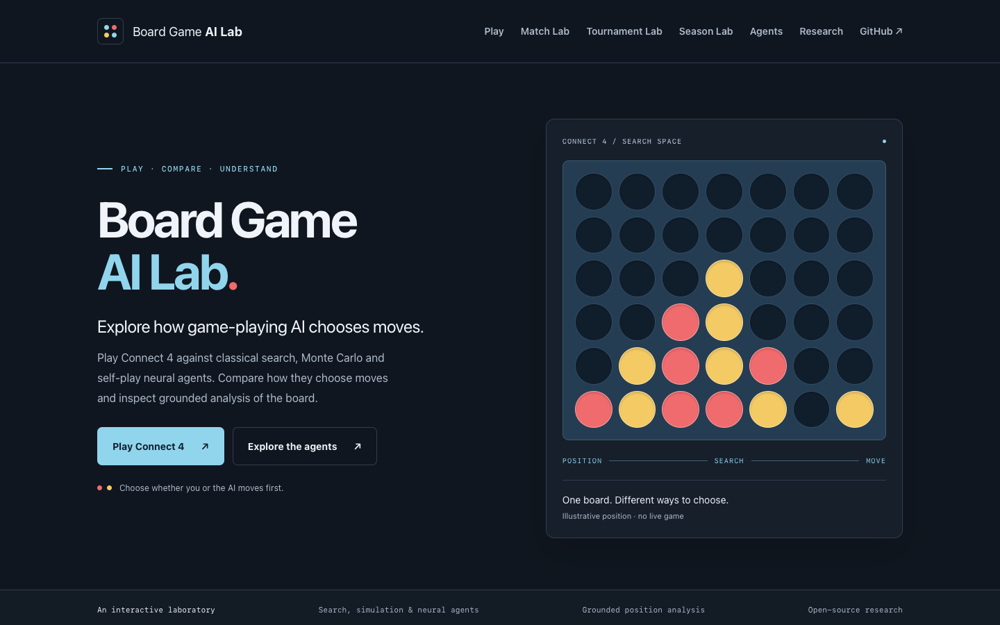
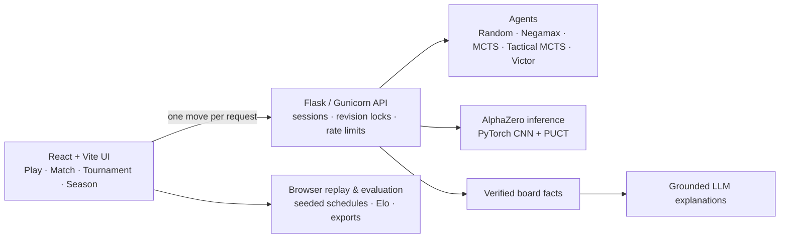
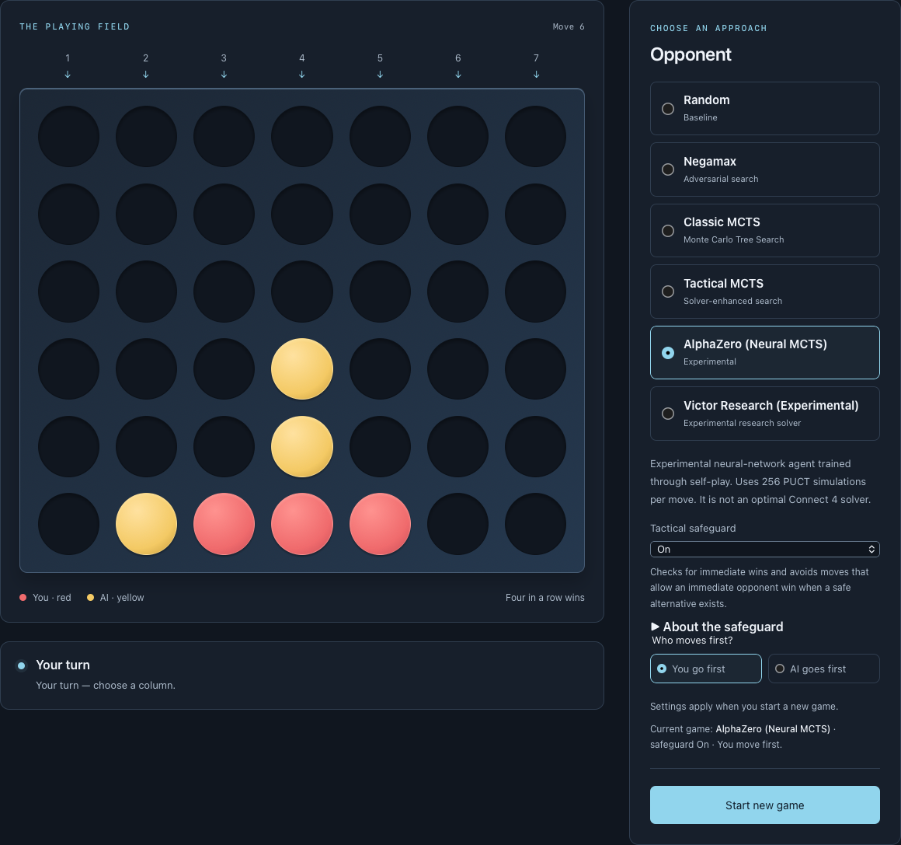
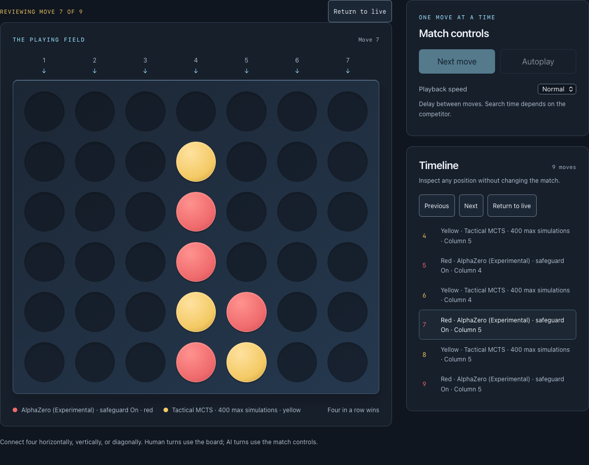
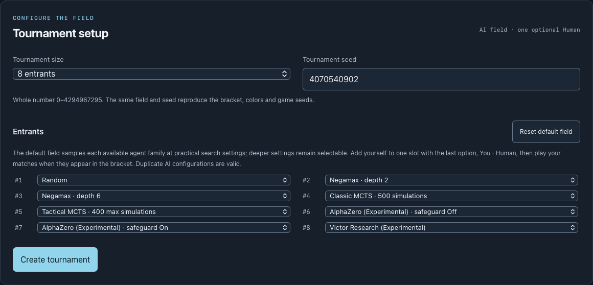

# Board Game AI Lab

A full-stack laboratory for building, comparing and explaining game-playing AI. Play Connect 4 against six kinds of agent, from classical search to a PyTorch policy/value network trained through self-play. Run reproducible competitions between them and inspect grounded analysis of any position.

**[Open the live application](https://board-game-ai-lab-ui.onrender.com/)** · [Play](https://board-game-ai-lab-ui.onrender.com/connect4) · [Match Lab](https://board-game-ai-lab-ui.onrender.com/connect4/match-lab) · [Tournament Lab](https://board-game-ai-lab-ui.onrender.com/connect4/tournament) · [Season Lab](https://board-game-ai-lab-ui.onrender.com/connect4/season)



## Overview

Board Game AI Lab puts several game-playing approaches behind one game engine and one API, so they can be played, compared and evaluated on equal terms. A React interface drives a Flask service that runs each agent one move at a time. Competitions run in the browser with seeded, replayable schedules, and their results export as verifiable evidence. An optional LLM layer explains positions using only facts the engine has verified.

## What you can do

| Interface | What it does |
| --- | --- |
| **Play** | Choose an opponent and its settings, pick who moves first, and play a game. |
| **Match Lab** | Pit any two competitors (Human or AI) against each other, step through moves or autoplay, and review the timeline. |
| **Tournament Lab** | Run a seeded single-elimination bracket of 8–64 entrants, and optionally enter it yourself. |
| **Season Lab** | Run a balanced AI round robin with exact Red/Yellow balance, standings, Elo ratings, pairwise results and verifiable exports. |
| **Position analysis** | Ask about the last move, the current position, or a hypothetical move, and get an explanation grounded in verified board facts. |

## AI agents

| Agent | Approach | Status |
| --- | --- | --- |
| **Random** | Uniform choice among legal moves; the baseline. | Playable |
| **Negamax** | Depth-limited adversarial search with alpha-beta pruning, a transposition table and a heuristic evaluation. Depths 1–12. | Playable |
| **Classic MCTS** | UCT Monte Carlo Tree Search with random rollouts and root tactical checks. Presets 500–25,000 simulations. | Playable |
| **Tactical MCTS** | MCTS with tactical rollouts and MCTS-Solver proof propagation. Stops early once a position is proven. Presets 200–10,000 simulations. | Playable |
| **AlphaZero** | A 325,896-parameter policy/value CNN trained through self-play, guiding 256 PUCT simulations per move, with an optional tactical safeguard. | Playable · Experimental |
| **Victor Research** | Strategy inspired by Victor Allis's Connect 4 rules, an exact opening book, and bounded optimal-move proof search with a heuristic fallback. | Playable · Experimental |

None of the agents plays perfectly. AlphaZero and Victor Research are research agents: they can lose, and the interface labels them as experimental. Earlier DQN and neural-MCTS experiments remain in the repository as research code and are not playable.

## Technical highlights

- **AlphaZero-style self-play training in PyTorch.** The agent generates its own games, training a convolutional network with a policy head (which columns look promising) and a value head (who is winning). The public model is the [Phase 4D.4H-C generation-6 CNN, seed 42](docs/phase4d4k-a-alphazero-backend.md#4-selected-checkpoint-and-justification).
- **Neural inference with PUCT search.** The network's policy and value guide Monte Carlo Tree Search over a bitboard game state. Before release, the production inference path matched 12,485 recorded research decisions with zero mismatches. Every AlphaZero game records the model hash and search settings.
- **Search optimizations.** Bitboard MCTS and an optimized Negamax compute the same decisions as before, but MCTS runs 54–72× faster at equal simulation budgets. A solver-enhanced Tactical MCTS variant came out of a [controlled search study](docs/search-mcts-v3/REPORT.md).
- **Optional tactical safeguard.** A conventional one-ply check after AlphaZero's search takes immediate wins and avoids handing one over. It is offered as a separate configuration, not presented as a stronger model.
- **Session-safe Flask API.** The server commits one legal move at an exact revision under a per-game lock, keeps immutable move history, and enforces bounded sessions, rate limits and search concurrency. Clients reconcile with the server rather than blindly retrying ambiguous requests.
- **React game and evaluation workflows.** Play, Match, Tournament and Season Labs share one competitor model. AlphaZero appears only when the backend reports it available; Victor Research sits behind matching frontend and server flags. Competitions survive reloads through validated local persistence.
- **Reproducible, verifiable evaluation.** Seeds determine brackets, schedules, colors and game seeds. Season exports carry versioned provenance and a SHA-256 evidence digest, and a standalone verifier legally replays every game.
- **Grounded LLM explanations.** The engine computes tactical facts deterministically. The LLM only selects among verified fact IDs and curated strategy references, and it never chooses moves.
- **ARM64 deployment and CI.** GitHub Actions runs backend and frontend tests, builds and smoke-tests native ARM64 Docker images, and runs AlphaZero inference checks on a native ARM64 runner. Commit-pinned API images are published to GHCR; deployment remains a manual, documented step.

## Architecture



The browser owns competition scheduling, replay and analytics; the API owns game state and move execution. The public UI is a static Render site. The API runs in Docker on an ARM64 Mac mini behind a Tailscale Funnel HTTPS endpoint, as one Gunicorn worker so session state stays consistent. PyTorch is needed only when AlphaZero is enabled; the default API image is torch-free.

## Evaluation and results

**Historical canonical benchmark (frozen).** [`canonical-season-v1`](benchmarks/connect4/results/canonical-season-v1/README.md) is a balanced 8-agent, 112-game round robin with exact color balance (seed `20261008`). Its field is Random, Negamax depths 2/4/6/8 and the original Classic MCTS at 100/400/800 simulations. Negamax was the strongest family: depths 6 and 8 each scored 71.4%, and the best MCTS entrant scored 53.6%. Red scored 55.4% overall. The benchmark predates Tactical MCTS, AlphaZero and the current search presets, so it does not rank those agents. Its results are preserved unchanged and verify with:

```sh
node ui/scripts/verify-evaluation-export.mjs benchmarks/connect4/results/canonical-season-v1/evaluation.json
# Verification PASS
# COMPLETE: 112/112 games
```

**AlphaZero research results.** In a controlled study from varied openings (Phase 4D.4J-B, safeguard Off), the public model scored about 54% against Negamax depth 3 and about 36% against Negamax depth 5. It is a working self-play agent, not a strong or perfect player. In a [confirmation study](https://github.com/andrewcukierwar/board-game-ai-lab/blob/phase4d4j-b-tactical-guard-confirmation/docs/phase4d4j-b-alphazero-tactical-guard-confirmation.md), the optional safeguard improved match score by +1.30 percentage points (95% interval +0.52 to +2.34), pooled across the two trained CNNs studied. That is a real but small effect, below the +2-point practical threshold declared in advance.

**Tactical MCTS research results.** On 256 held-out openings, the solver-enhanced variant scored 74.2% against Classic MCTS at equal simulations and 70.8% at equal search time. This is a head-to-head research comparison, not a measurement of the current public presets.

**Interpreting results.** All of these are bounded, seeded evaluations against specific opponents. Season Lab ratings describe one field and schedule; they are not universal Connect 4 ratings. The [evaluation provenance contract](docs/evaluation-provenance.md) explains what exports do and do not prove.

## Tech stack

- **Machine learning and search:** Python 3.11, PyTorch (CPU inference), NumPy, custom Negamax, MCTS, PUCT and bitboard implementations
- **Backend:** Flask, Gunicorn, OpenAI Responses API (optional explanations, standard-library HTTPS client)
- **Frontend:** React 19, Vite, React Router, Axios
- **Testing:** pytest, Node test runner with jsdom, Playwright (Chromium, Firefox, WebKit)
- **Infrastructure:** Docker (ARM64), Nginx, GitHub Actions, GitHub Container Registry, Render static hosting, Tailscale Funnel

## Running locally

With Docker running, from the repository root:

```sh
docker compose up --build
```

Open http://localhost:3000. Gameplay needs no API keys. The default Compose setup is torch-free, so AlphaZero is hidden; enabling it needs an API image built with `ALPHAZERO_RUNTIME=true` and `ALPHAZERO_ENABLED=true` at runtime, as described in the [runtime dependencies](docs/alphazero-runtime-dependencies.md).

For development, with Python 3.11 and Node 22.12+:

```sh
python3.11 -m venv .venv && source .venv/bin/activate
pip install -r requirements-dev.txt
EXPLANATIONS_ENABLED=false gunicorn api.app:app --bind 127.0.0.1:8000 --workers 1 --threads 4

# in another terminal
cd ui && npm ci && npm run dev
```

Run tests with `EXPLANATIONS_ENABLED=false python -m pytest tests -q` and `cd ui && npm test && npm run build`. See the [quickstart](docs/quickstart.md) for explanation-provider settings, and the [verification record](docs/final-portfolio-packaging.md) for Playwright browser-suite commands against an isolated local API.

## Further documentation

- [AlphaZero backend integration and model selection](docs/phase4d4k-a-alphazero-backend.md) and [frontend release](docs/phase4d4k-b-alphazero-frontend.md)
- [AlphaZero v2 design review](docs/phase4d3-alphazero-v2-review.md) and [core implementation](docs/phase4d3a-alphazero-v2-core.md)
- [Classical search optimization](docs/classical-search-optimization.md) and [MCTS v3 research report](docs/search-mcts-v3/REPORT.md)
- [Canonical benchmark methodology](benchmarks/connect4/canonical-season-v1.md) and [evaluation provenance](docs/evaluation-provenance.md)
- [Victor Research: performance and integration](docs/victor-performance-and-integration.md), [opening book](docs/victor-opening-and-app-readiness.md) and [proof search audit](docs/victor-astra-second-pass.md)
- [Grounded explanations](docs/allis-grounding.md) and [LLM configuration](docs/llm-explanations.md)
- [Mac mini deployment, hardening and rollback](docs/mac-mini-deployment.md)
- [Project and research history](project_plan.md)

<details>
<summary>More screenshots</summary>







Captured from the real application against a local staging backend; see [capture notes](docs/assets/README.md). Interface examples, not benchmark evidence.

</details>
