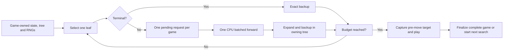

# Phase 4D.4C — Batched inference across independent self-play games

The opt-in pool-eight collector is **1.561× faster** than the unchanged
Phase 4D.4B bitboard search under the new matched per-game RNG protocol,
with **1.548×** observer-free confirmation. **All ten acceptance criteria PASS**.
Larger batches change floating-point neural outputs within declared limits;
no root-visit, action, trajectory or outcome differences occur in the tested
workloads. The official campaign is preserved and is not reproduced by this
new RNG protocol.

This phase optimizes computation with frozen AlphaZero v2 weights. It introduces
an optional CPU inference API and independent-game collector, retaining the
architecture, PUCT formula, exact search budgets, root noise, action temperature,
training policies and final actor-relative labels. It is not a training campaign
or playing-strength assessment. The historical collector and engine default
remain unchanged. No main merge, deployment or checkpoint promotion is performed.

## Isolation and provenance

The dedicated `phase4d4c-alphazero-batched-inference` worktree starts at
Phase 4D.4B commit `df8a586db40d8b2a2fea9052758d6917ae412dcd`, inside the
historical checkout's ignored `experiment-output/phase4d4c-worktree` directory.
The historical checkout stays at `1894bc4d8f035cf738df8e3fc0ce234f1ce2c8be`.
No AGENTS.md files were present. The existing M4 virtualenv is used; no
packages are installed. Machine-readable evidence and execution-source snapshots
are retained in `research/alphazero_batching/results/phase4d4c-20261011/`.

The official directory remains
`/Volumes/Mini SSD/code/board-game-ai-lab-m4/experiment-output/phase4d3c-alphazero-v2-official-m4-20261008-110950/`.
Its declaration SHA256 remains
`c8ab2227d4b2c707b3185da8695a991f0914faede88ecd5f1c7fc84fb017b716`.
Each invocation checks the archived 150-file inventory, declaration and eight
checkpoint hashes before inference, then hashes all official bytes again in a
finally block. Sealed artifacts are hashed only, never parsed as evaluation
inputs. All measurements use fresh directories. No training, campaign resume,
canonical benchmark edit, service change or unrelated worktree modification occurs.

## Implementation and preserved semantics

`V2Inference.predict_batch` validates a list/tuple of nonterminal bitboards,
constructs one CPU float32 `(N,1,6,7)` tensor, runs one forward in eval and
inference modes, and returns ordered predictions. Encoding remains actor-relative,
top row first, physical columns 0–6, including signed zero in empty O-to-move
cells. Outputs are finite CPU float32 logits/scalar tanh values. Each row uses
the existing legal-only stable float64 softmax; illegal probabilities are exactly
zero even when legal-move sets differ. No precision, device or architecture
change is introduced. A singleton invokes unchanged `predict` directly; an
empty batch returns no predictions or forward calls.

Public batch validation checks integer/range constraints, disjoint pieces,
occupancy, turn counts, gravity and terminal/winner consistency. It does not
prove exhaustive historical reachability for arbitrary trusted-constructor
bitboards. Legal histories remain the input precondition, as with the existing
immutable state backend. Scheduler states start empty, advance legally, agree
with the engine after every move, and undergo complete replay at finalization.

`batching.py` implements a generator per game and a nested generator per
search. A game suspends on its root or selected nonterminal leaf. The driver
batches one pending request from each active game and sends predictions back
in ownership order. Terminal leaves back up exact results without inference.
A game can finish its search, select its action and start its next search while
another game is still searching. Finished games immediately free a slot for
pending identities. The tail naturally shrinks; no dummy/padded positions occur.

Selection uses the existing PUCT helper and backup function, unchanged legal
column order and the same uncounted root prediction. Each root and root-edge
visit sum equals exactly 256 in measured self-play. Trees are new per move,
independent, single-parent and strictly sequential. There is no virtual loss,
transposition, shared tree, proof propagation, tactical guard or altered noise.
Action temperature is one before zero-based ply eight and zero afterward;
targets always normalize raw visits. Captures precede moves and labels use the
actual completed winner relative to the captured actor.

The collector returns completed games sorted by ID, independent of completion
order. On an exception no dataset is returned. An `on_game` observer may already
have received explicitly complete games, matching historical attempt-accounting
semantics; pending games never become labeled records. Cancellation checks run
before each batch and simulation; a running forward cannot be interrupted.
Outstanding requests and trees are bounded by the active pool. Completed dataset
storage grows only with the finite requested number of games.

## New experimental randomness protocol

Game seeds use the full SHA256 integer of ASCII
`connect4-az-independent-games-v1:{base_seed}:{generation}:{game_index}:{domain}`,
interpreted big-endian. Domains are `search`, `action` and `noise`. Python
`random.Random` owns search and action streams; V2RootNoise owns its separately
hashed PCG64 stream. Generation and game indices are nonnegative integers.
No randomness is consumed on waits, dispatch or refill. Pool slots never own RNGs.

`collect_serial_reference` uses these same streams with the unchanged
Phase 4D.4B bitboard PUCT and serial `play_game`. This protocol is new experimental
collection provenance. It does **not** reproduce the historical official campaign's
shared sequential streams or trajectories. With deterministic fake predictions,
changing pool size or ID order leaves complete trees, decisions and RNG states
exactly unchanged. Real networks can change rounding when batch composition
changes; that possibility is explicitly measured rather than masked.

## Prospective numerical and behavioral gates

[DESIGN.md](../research/alphazero_batching/DESIGN.md) was written before results.
Batch one requires exact inputs/outputs, trees, decisions, examples and final
RNG states. Larger batches require maximum absolute differences of at most
2e-5 logits, 2e-6 values and 2e-6 masked policy probabilities on fixed inputs
across all eight checkpoints. Repeated executions at fixed runtime, configuration,
identities, order and batch size must match exactly.

Fixed-state noisy search screens are root visit L1 divided by budget at most
0.10 and selected-action disagreement at most 5%. Screens are checked separately
by requested size and temperature, avoiding dilution by singleton cases.
Complete-trajectory divergence above 10% or final-outcome differences above 5%
requires investigation; unresolved material differences fail acceptance.
All finite/legal/label/normalization/budget invariants are mandatory regardless
of numerical proximity. No threshold is relaxed after results.

## External methodology references

The pinned [eugeneyp self-play source](https://github.com/eugeneyp/connect4-alphazero/blob/a936aadd74a6a6dd9035e576b89aeb5a3ea7ef73/src/training/self_play.py)
and search batch independent roots/leaves and refill completed slots.
[Suharshkumar](https://github.com/suharshkumar/connect4-selfplay-rl/blob/ed5c601783610e1df7b7e32758140160449e973e/c4/mcts.py)
uses independent lockstep trees and excludes terminal leaves from neural batches.
[Kuotunyu](https://github.com/kuotunyu/alphazero-connect4/blob/0ca5789237911127edea8dca3b3786d0c148ee89/src/az/selfplay.py)
explicitly keeps one leaf per tree per tick, without virtual loss, and refills
finished games. [AlphaZero.jl](https://jonathan-laurent.github.io/AlphaZero.jl/stable/reference/params/)
uses an inference server for independent simulation tasks and optional filled
batches. The three Python repositories' source hashes and the Julia documentation
URL/method are recorded in `external_sources.json`.

Those strategies motivate independent-tree scheduling here. Their hardware,
hyperparameters, root accounting and RNG conventions differ; they are not
proof of superiority and their published gains are not our measurements.
No external code, training schedule or network architecture was copied.

## Results

The primary experiment uses the Apple M4 Mac mini (10 CPU cores, 16 GiB RAM),
macOS 26.6.2 arm64, CPython 3.11.17, Torch 2.10.0 and NumPy 1.26.4.
CPU float32, deterministic algorithms, one intra-op/inter-op thread and all five
vector thread controls pinned to one are recorded per invocation. The existing
virtualenv is `/Users/andrewcukierwar/.venvs/board-game-alphazero-m4`.

### Exact and numerical validation

Fixed inputs comprise the seven Phase 4D.4A development positions and mirrors.
There are 560 prediction and 560 fixed noisy-search comparisons across all eight
checkpoints, requested capacities 1/2/4/8/16 and 256 simulations. Capacity sixteen
actually processes at most fourteen fixed states; this is not a frozen-network
batch-sixteen or complete-collection throughput claim. Focused unit tests also
exercise an actual sixteen-position tensor with a deterministic initialized net.

| Quantity | Fixed-input max error | Complete-game root max error | Declared limit |
|---|---:|---:|---:|
| Raw logits | 8.5831e-6 | 1.1444e-5 | 2e-5 |
| Scalar value | 2.9802e-7 | 4.4703e-7 | 2e-6 |
| Masked policy | 6.4041e-7 | 9.3409e-7 | 2e-6 |

Every fixed-search root visit vector and selected action at both temperatures
matches exactly. Search/noise RNG states also match. Batch-one complete validation
covers two games per checkpoint at 256 simulations: **517 decisions** retain
full-tree hashes and exact decision/RNG comparisons. Larger requested capacities
2/4/8 repeat four complete games per checkpoint with exact records, decisions and
final RNG states. Their actual active pool is at most four; actual pool eight is
validated with sixteen games and repeated trials for both performance checkpoints.

There are zero trajectory, outcome or example differences among matching IDs
in all-eight-checkpoint validation (sixteen matched games per larger configuration)
and primary collection (64 matched game observations per configuration). In the
primary records all 2,272 root visit vectors/actions per condition also match.
All configurations reproduce records, sorted decisions and final RNG hashes
exactly across the repeated trials. Larger-batch **neural outputs are not bitwise
equal**, even though the tested discrete searches/trajectories agree.

### Complete-game throughput

Primary candidates collect sixteen empty-board games for each of 42/g10 and
314159/g20, repeated twice with condition order reversed. Both actors use the
same frozen model. IDs 0–15, experimental generation 21, base seed 4404003 and
256 simulations are matched. Thus each condition contains 64 completed observations
of 32 unique checkpoint/game identities, not 64 independent games.

| Collector / pool | Wall s | Games/s | Games/hour | Positions/s | Speedup | Mean batch |
|---|---:|---:|---:|---:|---:|---:|
| Serial bitboard | 105.736 | 0.605 | 2,179 | 21.49 | 1.000× | 1.000 |
| Batched 1 | 108.438 | 0.590 | 2,125 | 20.95 | 0.975× | 1.000 |
| Batched 2 | 86.525 | 0.740 | 2,663 | 26.26 | 1.222× | 1.919 |
| Batched 4 | 75.811 | 0.844 | 3,039 | 29.97 | 1.395× | 3.559 |
| Batched 8 | 67.741 | 0.945 | 3,401 | 33.54 | 1.561× | 6.950 |

Each condition performs **64 games / 2,272 plies / 581,632 simulations /
453,870 neural positions**. Forward calls are 453,870 / 453,870 / 236,542 /
127,526 / 65,304 for serial / 1 / 2 / 4 / 8. Equal trajectories make these equal-work
end-to-end comparisons, without game-length adjustment. All four paired batch-eight
speedups are 1.550–1.574×. CPU/wall ratios remain approximately one.

Batch eight meets the prospective **1.3×** target at **1.561×**. Batch four also
meets it; batch two does not. Singleton scheduling is 2.5% slower than the serial
reference, consistent with extra validation, dispatch and per-simulation cancellation
checks; that is observed overhead, not a changed search budget.

An additional confirmation with the original V2Inference, no inference-counting
wrapper and no decision recorder collects sixteen games per checkpoint/condition:
serial **52.568 s**, batch eight **33.969 s**, **1.548×**. Complete-record hashes
and RNG hashes agree. This confirms the gain is not an instrumentation artifact.

Actual pool-eight forward-size distribution is:

| Actual size | 1 | 2 | 3 | 4 | 5 | 6 | 7 | 8 |
|---|---:|---:|---:|---:|---:|---:|---:|---:|
| Calls | 786 | 2,398 | 2,564 | 1,364 | 6,476 | 4,540 | 1,888 | 45,288 |

Mean per-game active residence is 1.65 / 1.69 / 2.63 / 4.48 / 7.82 seconds
for serial / 1 / 2 / 4 / 8. Mean completion time measured from collection
start is 13.96 / 14.32 / 11.93 / 11.44 / 12.05 seconds. All individual completion
and residence times remain in the trial records. Higher throughput therefore
comes with longer residence for an individual active game, relevant to collection
pipelines rather than interactive move latency. Every condition handles exactly
130,034 terminal leaves without neural evaluation.

### Fixed workload and runtime attribution

Fixed search uses fourteen identical states, 256 simulations each (3,584 total),
with 2,522 neural positions for every candidate. Three interleaved trials retain
all results. Inference separately evaluates the same fourteen states 32 times
(448 positions); it includes encoding, validation and legal softmax.

| Collector / pool | Median fixed-search ms | Simulations/s | Fixed-inference positions/s |
|---|---:|---:|---:|
| Serial | 567.82 | 6,312 | 4,940 |
| 1 | 580.66 | 6,172 | 4,917 |
| 2 | 454.28 | 7,889 | 6,511 |
| 4 | 406.04 | 8,827 | 7,346 |
| 8 | 366.66 | 9,775 | 8,428 |

Primary inclusive inference-pipeline shares are **90.71% serial** and
**81.12% batch eight**. This includes encoding, validation, model forward and
output processing. Direct driver overhead at pool eight is about **0.15%**;
generator advance time contains traversal, backup, capture and observers.
Per-game observer search durations include suspension and are never summed.

Separate eight-game profiles preserve additive exclusive categories:

| Exclusive category | Serial % | Pool 8 % |
|---|---:|---:|
| Neural forward, including contracts | 70.25 | 66.99 |
| Inference wrapper residual | 12.53 | 6.58 |
| Legal float64 softmax | 3.10 | 3.86 |
| Batch-state validation | 0.00 | 1.23 |
| Singleton encoding/tensor construction | 2.55 | 0.03 |
| Selection | 4.54 | 8.23 |
| State transitions | 2.97 | 7.12 |
| Expansion bookkeeping | 1.87 | 2.44 |
| Backup | 0.30 | 0.44 |
| Other | 1.89 | 3.08 |

Batched encoding/tensor construction is inside wrapper residual, so the singleton
encoding row cannot be interpreted as disappearance of that cost. These profiles
include instrumentation overhead and use a different sample from the primary
collection. Inclusive profile categories overlap, especially singleton calls
nested within predict_batch; primary inclusive timing uses one outer timer.

### Memory, preservation and budget

Fresh processes load 42/g10, warm the declared inference capacity and collect
sixteen identical IDs. Tracemalloc probes are separate from throughput trials.

| Collector / pool | Python-traced peak MiB | Process lifetime RSS MiB |
|---|---:|---:|
| Serial | 16.00 | 311.47 |
| 1 | 15.64 | 313.34 |
| 2 | 17.21 | 315.70 |
| 4 | 20.01 | 320.30 |
| 8 | 28.10 | 354.22 |

Pool eight increases traced peak by 75.6% and RSS by 13.7% relative to serial
in these probes; it stays below the prospective **64 MiB traced / 1 GiB RSS**
limits. Growth is consistent with more simultaneous trees, while
pool/refill/exception tests and max-active counters establish bounded ownership.
Tracemalloc excludes most native tensor memory. RSS is a process high-water mark
including imports, loading, warmup and tracing; these are not incremental
search-only RSS measurements or a statistical memory guarantee.

All **ten** invocations finish successfully, preserve **150 byte-identical files**
and consume **1,145.33 seconds / 19.09 minutes**, including numerical validation
and all profiling/memory/confirmation probes. No failed measured attempts,
training run, large strength tournament, four-thread supplement or pool-sixteen
performance trial occurs. Ordinary implementation/testing time is separate.

### Tests, independent review and acceptance

The complete relevant regression suite passes: **776 passed, 2 optional skips**
in **281.45 seconds**, including **69 new focused batching tests**. The skips
remain the optional retained-v1-checkpoint checks absent from the isolated
worktree. The command and complete output are in `tests-final.txt` and the tooling
README. Tests include tensors/bytes, malformed batches, mixed masks, both actors,
mirrors, tactical states, draws, complete games, every-node fake equivalence,
order/refill/RNG/global-RNG isolation, exceptions, bounded cancellation, partial
failure, capture/label normalization, model immutability and default-path isolation.

A separate reviewer inspected the code, independently ran the initial focused
suite, recalculated raw numerical/performance/memory evidence and examined the
report. It identified aggregation, scope-labeling and attribution issues; these
were resolved through explicit per-size/temperature screens, repeated primary
record/RNG checks, full singleton tree hashes and accurate reporting. No tolerance
or target was weakened and no trial was discarded. Its review is retained in
`REVIEW.md`; no unresolved material finding remains.

| Acceptance criterion | Result | Evidence |
|---|---|---|
| 1. Batch one exactly matches new serial reference | PASS | Full fixed trees; 517 frozen complete decisions/tree hashes; records and all RNGs |
| 2. Independent trees, legal actions, budgets, streams and targets | PASS | Every-node fake comparisons across capacities/order; engine replay; exact budgets/labels |
| 3. Prospective numerical accuracy/reproducibility | PASS | All eight checkpoints; both error tables within limits; per-size screens/repeats exact |
| 4. At least 1.3× additional complete-game throughput | PASS | Pool eight 1.561×, all pairs ≥1.550×; confirmation 1.548× |
| 5. End-to-end measured gains | PASS | Equal completed games, plies, simulations and neural positions; direct collection wall |
| 6. Acceptable bounded memory, no deadlock/corruption | PASS | Pool eight 28.10 MiB traced / 354.22 MiB RSS; bounded active pool; failure/cancel tests |
| 7. Relevant existing and new tests | PASS | 776 passed / 2 optional skips, 69 new tests |
| 8. Eight archived checkpoints unchanged | PASS | Before/after full-file inventories and frozen checkpoint hashes |
| 9. All 150 official files byte-identical | PASS | Every invocation and final verification; declaration SHA unchanged |
| 10. Defaults/production paths unchanged unless selected | PASS | Baseline search/selfplay/bitboard/config/data bytes unchanged; original single prediction code unchanged |

Acceptance applies to the declared runtime and tested workloads. Pool eight is
available only by an explicit collector call. No campaign, production factory,
service or training pipeline is wired to use it automatically.

## Limitations and next experiment

Pool eight is the best **tested** principal setting, not a universal optimum.
The sample uses two learned checkpoints and sixteen identities per checkpoint,
with repeated timing observations rather than additional independent games.
Other generations, budgets, architectures or CPUs can change batch efficiency.
The finite collection tail lowers mean occupancy to 6.95 of eight. Per-game
residence latency rises while aggregate collection throughput improves.
Batch-dependent rounding can cross future discrete PUCT/action thresholds even
though no such behavioral divergence occurs in this sample. No playing-strength
claim follows from this computational optimization.

If more compute optimization is needed, the smallest justified follow-up is a
separate fixed-work study of repeated inference contract checks, encoding and
output conversion: neural forward still dominates, and driver overhead is tiny.
Do not weaken validation globally or assume larger pools or extra threads help.
No missed acceptance gate was repaired by expanding the experiment scope.

The recommended next research experiment is **exploration/replay diversity**:
with frozen checkpoints and the explicitly selected pool-eight collector, compare
the present eight-ply exploratory schedule with a longer schedule in fresh,
bounded collections. Track unique opening families, duplicate positions after
ply eight, visit-target entropy and missed immediate wins/unsafe replies before
considering a separately declared resumable exploratory learning run. This is a
hypothesis about improving training information, not proof of stronger play.
Tactical root safety/proof propagation remains a separate strength experiment.
No diversity, tactical, replay, residual-network or training changes are made here.
