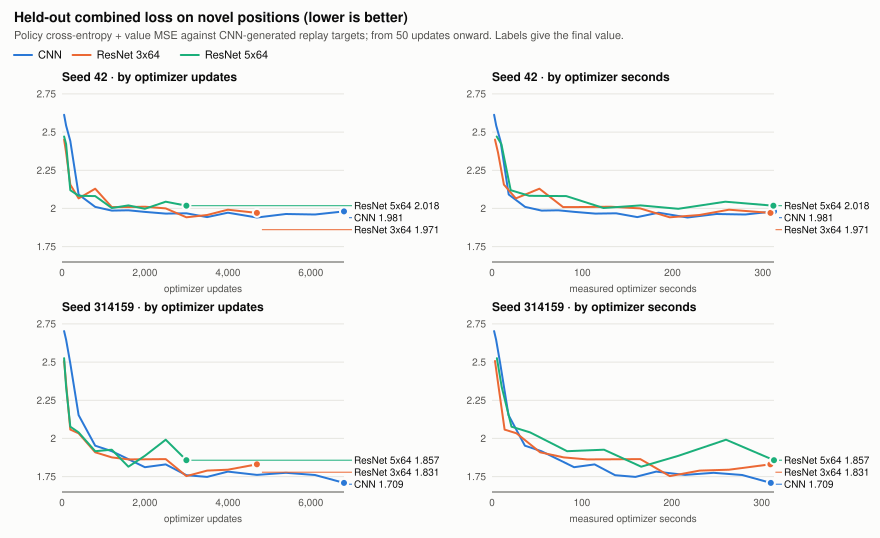
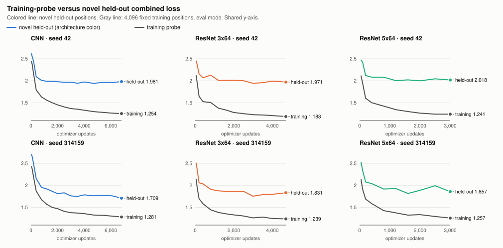

# Phase 4D.4H-B — ResNet cost and fixed-data learning benchmark

## Summary

**Neither ResNet showed an advantage over the CNN that survives equal
computation, and the offline evidence does not show that a residual network is
a better replacement.** ResNet 3x64 is a reasonable candidate for one
controlled self-play test; ResNet 5x64 is not, at present.

- **Cost.** ResNet 3x64 costs about 1.45x the CNN per training update and
  1.46x per self-play search position. ResNet 5x64 costs about 2.3x and 2.15x.
  Memory is the same for all three.
- **Learning per update.** Both ResNets fit the replay policy faster early
  (better at 400 updates on both seeds), and both keep a raw tactical-accuracy
  lead of 2.5 to 14.5 points at every shared checkpoint from 400 updates on. The
  policy-loss lead fades to nothing by about 3,500 updates. On the declared
  primary loss the 3x64 is inconclusive and the 5x64 is worse, because of its
  value error.
- **Learning per second.** With equal optimizer time the CNN completes 1.45x to
  2.27x as many updates and the differences disappear or reverse. The 3x64
  ends level with the CNN on exact-label accuracy and 0.010 nats behind on
  policy loss; the 5x64 ends 0.027 nats behind.
- **What limits the conclusion.** The targets were produced by CNN self-play,
  there is one initialization per architecture and seed, and the held-out value
  error swings by up to 0.16 between adjacent checkpoints of one run, which is
  as large as the differences between architectures.

| Question | ResNet 3x64 | ResNet 5x64 |
|---|---|---|
| Better learning at equal updates (3,000)? | Inconclusive on the primary loss; better on policy loss and tactical accuracy | Worse on the primary loss; better on tactical accuracy |
| Better learning at equal wall time? | No: inconclusive on the primary loss, worse on policy loss | No: worse |
| Better raw tactical accuracy? | At equal updates yes (+5.5 points); at equal time no (0.0) | At equal updates yes (+9.2 points); at equal time no (+0.7) |
| Acceptable memory? | Yes (at most 1.05x the CNN, under 330 MiB) | Yes (same) |
| Acceptable inference and self-play throughput? | Acceptable with a smaller equal-wall budget: 1.46x per search position | Costly: 2.15x per search position |
| Recommended for an independent self-play experiment? | Yes, as the single ResNet arm | Not now |

The measured run completed all five stages in 44.9 minutes. With the pilot and
smoke test the phase used 47.8 minutes of measured work against a 60-minute
target and a 75-minute limit. **The supervisor ended with status
`INTEGRITY_FAILURE`**, which is explained under
[Run status](#run-status-and-the-integrity-flag): a separate session committed
Phase 4D.4G's final analysis in its own worktree while this run was going. No
checkpoint or evidence file of that phase changed, and all 150 official
campaign files are byte-identical.

Nothing was merged, promoted or deployed, and no self-play training was run.

## Scope and isolation

Worktree `experiment-output/phase4d4h-b-worktree`, branch
`phase4d4h-b-resnet-benchmark`, created from
`7f5182daa10156e04a8b0f7727d9bec9cad39cf1`. No file under `games/` changed, so
the three architectures ran from one revision with the execution-source
identity Phase 4D.4H-A published
(`3523ee04a4b523a915941379ed66871687e6163baa8c363fedddbce2c84da934`).

| Added | Content |
|---|---|
| `research/alphazero_resnet_benchmark/` | Protocol, tools, architecture review, results, figures |
| `tests/test_alphazero_resnet_benchmark.py` | Eight cases for the split, calibration and uncertainty logic |
| `docs/phase4d4h-b-resnet-benchmark.md` | This report |

The protocol is [DESIGN.md](../research/alphazero_resnet_benchmark/DESIGN.md).
It was committed and pushed as `bc59dc1` before any measured stage, and the
supervisor recorded that commit at launch. Complete tables are in
[results/tables.md](../research/alphazero_resnet_benchmark/results/tables.md).

Phase 4D.4G's final report was not available when the design was frozen. It
was published during this run. It keeps eight exploratory plies and recommends
this phase; nothing in it changes the design or the analysis here.

## Run status and the integrity flag

| Stage | Outcome | Wall seconds |
|---|---|---|
| Inference benchmark | Complete | 134.8 |
| Training-update benchmark | Complete | 143.2 |
| Collection benchmark | Complete | 134.1 |
| Fixed-data learning, seed 42 | Complete | 1,142.6 |
| Fixed-data learning, seed 314159 | Complete | 1,138.1 |

There were no retries, no failed stages and no change to any budget.

At launch the supervisor recorded the Phase 4D.4G worktree's commit,
cleanliness and a hash over its 151 output files, and compared them at the
end. The commit had changed from `b4b1d9f` to `01526b8` ("complete Phase 4D.4G
exploration ablation results", committed 12:36 local time by a separate
session), so the comparison failed and the final status is
`INTEGRITY_FAILURE`. That status file is unchanged.

[`adjudicate.py`](../research/alphazero_resnet_benchmark/adjudicate.py),
written after the run, re-derived the facts and recorded them in
`results/integrity-adjudication.json`:

- The output inventory hash is identical before, after and now: no Phase
  4D.4G checkpoint, boundary or execution-evidence file changed.
- The commit is the only field that differs. The new commit descends from the
  frozen one, changes 138 paths under `docs/`, `research/` and `tests/` and
  none under `games/`, and the worktree is clean.
- All 150 official files are byte-identical. This phase's frozen sources,
  design and dataset are unchanged.

This phase has no code path that writes to that worktree. The check was too
strict: it treated any new commit there as a modification. Because the
frozen analysis refuses any status but complete, the analysis was invoked
through the adjudication tool, which calls the unmodified
`analyze.analyze()`. This is a deviation from the declared procedure and is
reported as one.

**Consequence for the measurements.** The other session was computing on this
machine from about 12:11 to 12:36, during this run's inference, training
benchmark, collection and seed-42 learning stages. Seed 314159 trained almost
entirely after it finished. The timings show little disturbance:

| Milliseconds | CNN | ResNet 3x64 | ResNet 5x64 |
|---|---|---|---|
| Update, pilot (before the run) | 45.09 | 64.75 | 101.86 |
| Update, benchmark pass 1 / pass 2 | 45.95 / 47.25 | 69.24 / 65.69 | 109.85 / 103.70 |
| Update inside learning, seed 42 / seed 314159 | 45.94 / 45.61 | 65.64 / 65.87 | 103.92 / 104.55 |
| Search position, pilot | 0.1456 | 0.2148 | 0.3178 |
| Search position, collection block 1 / block 2 | 0.1523 / 0.1587 | 0.2249 / 0.2294 | 0.3275 / 0.3403 |

Per-update cost in the two learning seeds agrees within 0.8%, although only
one of them overlapped the other session. Seed 314159 is not a clean control
either: its largest excursion, 11% slow over 100 updates of the 3x64, came
after that session had ended. Processor time over wall time was at least 0.986
in every stage, so this run was not kept off its core. The training benchmark's first pass is up to
6% slower than its second for the ResNets, so the benchmark figures carry
noise of that order; cost ratios from the learning runs (thousands of updates
each) are the more reliable ones and are quoted beside them.

## Architecture review and validation

Phase 4D.4H-A had no independent review. One was done here before any
benchmark, by this session, which did not write the implementation:
[architecture-review.md](../research/alphazero_resnet_benchmark/architecture-review.md).
**No material correctness finding; nothing was changed.** Evidence:
`results/validation.json`, 79 checks, all passed.

| Requirement | Result |
|---|---|
| Independent review of the implementation | A float64 reference forward pass that shares no code with `resnet.py` agrees to 3.5e-7 at initialization and 6.8e-7 after training, for both variants |
| Both ResNet checkpoint contracts | Inference artifacts round-trip bit-identically and refuse to overwrite; all twelve cross-architecture loads and restores are rejected |
| Fresh-process resume, both ResNets | Generation 2 from a saved generation-1 boundary is bit-identical in-process and in a new interpreter, including every batch-norm buffer. Also confirmed for the CNN |
| Batch-norm running statistics | Equal to an independent exponential-average recomputation to 2.5e-7; update counters equal trainer steps; inference leaves them unchanged |
| Optimizer compatibility | AdamW settings identical across the three; restore mid-run continues bit-identically; foreign optimizer states rejected |
| CNN backward compatibility | Official generation-20 inference artifacts load and match; the strict historical read forks through the current CNN factory with matching weights, replay digest and step count |
| Historical artifact isolation | ResNets refuse the historical weights and boundary; output is refused inside the campaign directory |

Three review observations matter for reading the results. Weight decay acts on
the function in the CNN but only on the effective learning rate in the ResNets,
whose convolutions all feed a batch norm. A ResNet's eval-mode and train-mode
outputs differ until its running statistics catch up. An untrained ResNet is
not normalized at inference, so the collection benchmark's game lengths say
little about trained networks.

## Dataset provenance and leakage audit

Generation 13-20 replay of seeds 42 and 314159, read-only, from the official
generation-20 resume boundaries through the pinned historical checkout's strict
reader. The rebuilt replay reproduces each boundary's digest. No new game was
generated and no sealed package was opened.

| | Seed 42 | Seed 314159 |
|---|---|---|
| Boundary SHA-256 | `2866722b…210b1` | `328022e5…74f9d6` |
| Games / positions | 2,048 / 68,856 | 2,048 / 64,514 |
| Training games / positions | 1,739 / 59,094 | 1,730 / 55,248 |
| Distinct training positions (mirror-canonical) | 24,772 | 26,082 |
| Held-out games / positions | 309 / 9,762 | 318 / 9,266 |
| Held-out families (with a novel position) | 180 (178) | 139 (136) |
| **Novel held-out positions (primary set)** | **7,616** | **7,018** |
| Held-out positions also in training, exact / mirror only | 2,053 / 93 | 2,176 / 72 |
| Of those, at ply 8 or later | 0 | 0 |

**A fully family-disjoint split was infeasible.** Every game shares the empty
board. Linking games that share any mirror-equivalent position from ply 8
onward still leaves one family with 827 of 2,048 games in seed 42 and 712 in
seed 314159; even from ply 16 the largest holds 122 and 52. The alternative,
declared before any optimization:

1. Families link on shared positions at ply 8 or later, the first greedy ply.
2. The two families per seed that exceed 5% of games (47% and 42% of games in
   total) stay in training.
3. Whole smaller families are held out, in a hash order, until 15% of games.
4. The primary evaluation set is the held-out positions that occur nowhere in
   training, in either orientation.

So exact and mirror leakage is zero in the primary set, and zero at ply 8 or
later in the whole held-out set. The remaining overlap is all before ply 8 and
is reported separately as "seen" positions.

Limitations of this split:

- Held-out games come only from smaller families. They under-represent the
  most-played lines and are shorter (31.6 against 34.0 plies in seed 42; 29.1
  against 31.9 in seed 314159).
- Related openings are only partly separated: 65% and 73% of held-out games
  share a six-move prefix with a training game, and under 1% an eight-move one.
- Training repeats positions heavily: 58% and 53% of training positions are
  repeats of another.

**Overlap with the development suites.** Two solved300 rows (seed 42) and four
(seed 314159) occur in training; none occur in held-out; no tactical200 row
occurs in either. At the compared checkpoints, solved accuracy excluding those
rows differs from the full figure by at most 0.005. Details:
`results/dataset-audit.json`.

## Frozen design

| | CNN | ResNet 3x64 | ResNet 5x64 |
|---|---|---|---|
| Parameters | 325,896 | 322,440 | 470,408 |
| Update budget | 6,800 | 4,700 | 3,000 |
| Measured optimizer seconds, seed 42 / 314159 | 312.4 / 310.1 | 308.5 / 309.6 | 311.8 / 313.6 |

Each architecture trains from its own deterministic initialization with the
unmodified factory trainer: AdamW, learning rate 3e-4, weight decay 1e-4, clip
5, batch 128, reflection probability 0.5. The minibatch and reflection streams
depend only on the seed, and the analysis verified from a running hash that
all architectures received identical batches at every shared update.

Budgets were set from the pilot so that each architecture gets about 305 s of
optimizer time. A first draft at about 360 s projected to 60.3 minutes, so it
was reduced before the freeze and before any training result existed. The
measured optimizer times above are equal within 1.3%.

Two things were seen before the freeze and are disclosed in the protocol: the
pilot's cost numbers, and loss values from a 60/40/20-update smoke run on seed
42's split. Neither set a budget, endpoint or threshold other than as stated.

## Cost benchmarks

Apple M4, one thread, deterministic algorithms, Python 3.11.17, Torch 2.10.0.
Every figure is a measurement.

### Neural inference

Full `predict_batch` path, median of seven repetitions:

| Batch | CNN ms (positions/s) | ResNet 3x64 ms (positions/s) | Cost vs CNN | ResNet 5x64 ms (positions/s) | Cost vs CNN |
|---|---|---|---|---|---|
| 1 | 0.207 (4,835) | 0.375 (2,668) | 1.81x | 0.536 (1,866) | 2.60x |
| 8 | 0.939 (8,517) | 1.527 (5,238) | 1.62x | 2.332 (3,431) | 2.50x |
| 16 | 4.798 (3,335) | 4.758 (3,363) | 1.00x | 7.317 (2,187) | 1.53x |
| 32 | 7.688 (4,162) | 7.763 (4,122) | 1.02x | 11.861 (2,698) | 1.55x |

Peak resident memory is 255 to 275 MiB for every architecture and batch size,
of which about 255 to 259 MiB is the interpreter and libraries. Weights and
statistics are 1.24, 1.23 and 1.80 MB.

Two things stand out. Every architecture is far more efficient per position at
batch 8 than at batch 16: the CNN drops from 8,517 to 3,335 positions per
second, a 2.6x loss, and the 3x64 from 5,238 to 3,363, a 1.6x loss. The cause
was not investigated. And the 3x64 matches the CNN at batches 16 and 32 only
because the CNN slows down more there, not because the 3x64 catches up.
Pool-eight therefore sits at the cheapest operating point for all three, where
the CNN's advantage is largest, and a larger pool would not close the gap.

### Self-play collection

Pool-eight, 256 simulations per move, 32 matched game identities each:

| | CNN | ResNet 3x64 | ResNet 5x64 |
|---|---|---|---|
| Complete games per second | 1.377 | 0.745 | 0.538 |
| Mean game length, plies | 21.6 | 28.1 | 25.8 |
| Total simulations | 176,640 | 230,400 | 211,200 |
| Neural positions | 149,665 | 189,081 | 178,239 |
| Neural positions per second | 6,440 | 4,401 | 2,998 |
| ms per neural position (vs CNN) | 0.155 | 0.227 (1.46x) | 0.334 (2.15x) |
| ms per ply (vs CNN) | 33.7 | 47.7 (1.42x) | 72.1 (2.14x) |
| Games per second normalized to 30 plies | 0.990 | 0.698 | 0.463 |
| Mean inference batch occupancy | 5.50 | 6.61 | 6.27 |
| Forward calls at the full batch of 8 | 50.4% | 59.4% | 54.1% |
| Inference share of wall time | 81.8% | 89.3% | 92.9% |
| Peak resident memory, MiB | 299 | 299 | 300 |

Simulation totals equal 256 times the plies played for every architecture.
Games per second is not comparable directly, because the untrained networks
played games of different lengths; cost per neural position and per ply are.
On those, a ResNet 3x64 self-play arm gets about 68% of the CNN's search per
second and a 5x64 arm about 47%. Occupancy is below eight because the pool
drains at the end of each 16-game block; a 256-game generation would run closer
to full. The pilot, which measured only full batches of eight, gave nearly the
same ratios: 1.48x and 2.18x. On the inference part of the search alone the
ratios are 1.60x and 2.44x; tree work, which is the same for every
architecture, dilutes them.

### Training update, batch 128

| | CNN | ResNet 3x64 | ResNet 5x64 |
|---|---|---|---|
| `trainer.step`, ms | 46.6 | 67.5 | 106.8 |
| Cost vs CNN, declared benchmark (range over all estimates) | 1.00x | 1.45x (1.43-1.49) | 2.29x (2.26-2.38) |
| Forward, ms | 24.2 | 29.1 | 45.9 |
| Backward, ms | 20.6 | 35.5 | 57.6 |
| Everything else, ms | 1.7 | 2.1 | 2.8 |
| Batch-norm cost per update, ms (share); by pass | — | 6.4 (9.6%); 6.4 / 6.4 | 12.9 (12.1%); 16.1 / 9.7 |
| Eval-mode forward at 128, ms | 24.0 | 25.9 | 38.7 |
| Peak resident memory, MiB | 315 | 314 | 324 |

Forward and backward together are 96 to 97% of an update. The range in the
cost row covers the benchmark's two passes, the pilot and both learning runs;
the benchmark's first pass ran 4 to 6% slow for the ResNets only. The
batch-norm cost was measured by replacing every batch norm with the identity
and timing the same update. For the 5x64 the two passes disagree, so its
figure is best read as 10 to 16 ms. The 5x64's peak memory also differed
between passes (324 and 279 MiB), so differences below about 45 MiB are noise. It explains 6 of the 3x64's 21 extra milliseconds; most of the
rest is in the backward pass. The 3x64's eval-mode forward at batch 128 is only
8% slower than the CNN's, and batch norm accounts for 0.6 ms of it. What
folding batch norm into the convolutions would save at batch 8, where the
ResNets are slowest relative to the CNN, was not measured.

## Fixed-data learning

Held-out policy cross-entropy, value error and suite accuracy have their own
figures:
[policy](../research/alphazero_resnet_benchmark/results/figure-heldout-policy.svg),
[value](../research/alphazero_resnet_benchmark/results/figure-heldout-value.svg),
[suite accuracy](../research/alphazero_resnet_benchmark/results/figure-suite-accuracy.svg).
Every curve point is tabulated in `results/tables.md`.

### Checkpoints

Novel held-out positions. CE is policy cross-entropy in nats; MSE is value
error.

| Seed | Model | Updates | Optimizer s | Novel CE | Novel MSE | CE+MSE | solved300 acc | tactical200 acc |
|---|---|---|---|---|---|---|---|---|
| 42 | CNN | 3,000 | 137 | 1.1893 | 0.7789 | 1.9683 | 0.707 | 0.470 |
| 42 | ResNet 3x64 | 3,000 | 197 | 1.1830 | 0.7588 | 1.9418 | 0.697 | 0.530 |
| 42 | ResNet 5x64 | 3,000 | 312 | 1.1933 | 0.8245 | 2.0178 | 0.750 | 0.550 |
| 42 | CNN | 6,800 | 312 | 1.1642 | 0.8167 | 1.9809 | 0.733 | 0.570 |
| 42 | ResNet 3x64 | 4,700 | 309 | 1.1798 | 0.7909 | 1.9706 | 0.720 | 0.560 |
| 314159 | CNN | 3,000 | 137 | 1.2086 | 0.5507 | 1.7593 | 0.677 | 0.480 |
| 314159 | ResNet 3x64 | 3,000 | 198 | 1.1880 | 0.5652 | 1.7532 | 0.697 | 0.530 |
| 314159 | ResNet 5x64 | 3,000 | 314 | 1.1992 | 0.6581 | 1.8573 | 0.693 | 0.585 |
| 314159 | CNN | 6,800 | 310 | 1.1747 | 0.5343 | 1.7090 | 0.717 | 0.550 |
| 314159 | ResNet 3x64 | 4,700 | 310 | 1.1800 | 0.6510 | 1.8310 | 0.707 | 0.560 |

For scale, Phase 4D.4G measured the generation-20 CNN itself at 0.733 and
0.690 on solved300 and at 0.535 and 0.525 on tactical200 with the raw policy.
Five minutes of from-scratch training on the replay reaches that level for all
three architectures, so the runs are not under-trained relative to the network
that produced the data.

### Equal updates

ResNet minus CNN, both at the same update count. Difference with 95%
family-bootstrap interval; negative favors the ResNet for losses, positive for
accuracies. Pooled gives the seeds equal weight.

**At 3,000 updates (primary).**

| Metric | ResNet 3x64, seed 42 | Seed 314159 | Pooled | Verdict |
|---|---|---|---|---|
| Novel CE+MSE (primary) | -0.026 [-0.093, +0.035] | -0.006 [-0.110, +0.077] | -0.016 [-0.076, +0.038] | Inconclusive |
| Novel policy CE | -0.006 [-0.015, +0.003] | -0.021 [-0.031, -0.009] | -0.014 [-0.020, -0.006] | Better |
| Novel value MSE | -0.020 [-0.086, +0.040] | +0.015 [-0.085, +0.095] | -0.003 [-0.061, +0.050] | Inconclusive |
| Top-1 agreement with search | +0.008 [-0.006, +0.020] | +0.016 [+0.001, +0.027] | +0.012 [+0.002, +0.020] | Better |
| solved300 accuracy | -0.010 [-0.048, +0.023] | +0.020 [-0.012, +0.055] | +0.005 [-0.020, +0.027] | Inconclusive |
| tactical200 accuracy | +0.060 [+0.005, +0.118] | +0.050 [-0.005, +0.102] | +0.055 [+0.016, +0.096] | Better |

| Metric | ResNet 5x64, seed 42 | Seed 314159 | Pooled | Verdict |
|---|---|---|---|---|
| Novel CE+MSE (primary) | +0.050 [-0.008, +0.112] | +0.098 [+0.041, +0.151] | +0.074 [+0.032, +0.114] | Worse |
| Novel policy CE | +0.004 [-0.006, +0.015] | -0.009 [-0.024, +0.006] | -0.003 [-0.011, +0.007] | Inconclusive |
| Novel value MSE | +0.046 [-0.010, +0.104] | +0.107 [+0.047, +0.164] | +0.077 [+0.035, +0.117] | Worse |
| Top-1 agreement with search | -0.006 [-0.022, +0.008] | -0.001 [-0.013, +0.009] | -0.003 [-0.013, +0.006] | Inconclusive |
| solved300 accuracy | +0.043 [+0.000, +0.086] | +0.017 [-0.015, +0.048] | +0.030 [+0.007, +0.052] | Better |
| tactical200 accuracy | +0.080 [+0.013, +0.154] | +0.105 [+0.030, +0.187] | +0.092 [+0.042, +0.150] | Better |

**Earlier update counts** (primary loss and policy loss verdicts):

| Updates | ResNet 3x64 CE+MSE | Policy CE | ResNet 5x64 CE+MSE | Policy CE |
|---|---|---|---|---|
| 400 | Better, -0.072 [-0.137, -0.012] | Better, -0.079 | Better, -0.061 [-0.115, -0.004] | Better, -0.080 |
| 800 | Inconclusive, +0.038 | Better, -0.033 | Inconclusive, +0.017 | Better, -0.026 |
| 1,600 | Inconclusive, +0.010 | Better, -0.019 | Inconclusive, -0.009 | Better, -0.016 |
| 3,000 | Inconclusive, -0.016 | Better, -0.014 | Worse, +0.074 | Inconclusive, -0.003 |

Both ResNets learn the policy faster per update, and the lead shrinks
steadily: 0.08 nats at 400 updates, 0.014 and 0.003 at 3,000. Raw tactical
accuracy is ahead of the CNN's at every one of the four update counts on both
seeds, by 2.5 to 14.5 points.

**The 3,000-update checkpoint flatters the 3x64, and the 5x64's solved
accuracy.** This was found by the independent review and is not part of the
declared analysis. The same contrast at every checkpoint the 3x64 and the CNN
share (the review's bootstrap; point values confirmed from the tracked
curves):

| Updates | 3x64 CE+MSE, seed 42 / 314159 | Pooled [95%] | Rule | 3x64 policy CE pooled [95%] | Rule |
|---|---|---|---|---|---|
| 1,200 | +0.023 / -0.041 | -0.009 [-0.057, +0.040] | Inconclusive | -0.030 [-0.039, -0.019] | Better |
| 1,600 | +0.021 / -0.001 | +0.010 [-0.027, +0.045] | Inconclusive | -0.019 [-0.026, -0.012] | Better |
| 2,000 | +0.034 / +0.052 | +0.043 [-0.005, +0.087] | Inconclusive | -0.019 [-0.028, -0.009] | Better |
| 2,500 | +0.034 / +0.034 | +0.034 [-0.014, +0.079] | Inconclusive | -0.006 [-0.014, +0.002] | Inconclusive |
| 3,000 (declared) | -0.026 / -0.006 | -0.016 [-0.078, +0.038] | Inconclusive | -0.014 [-0.020, -0.006] | Better |
| 3,500 | +0.014 / +0.041 | +0.028 [-0.024, +0.075] | Inconclusive | -0.006 [-0.014, +0.003] | Inconclusive |
| 4,000 | +0.020 / +0.013 | +0.016 [-0.052, +0.072] | Inconclusive | +0.004 [-0.005, +0.013] | Inconclusive |
| 4,700 | +0.030 / +0.069 | +0.050 [+0.004, +0.095] | Worse | -0.001 [-0.011, +0.009] | Inconclusive |

From 2,000 to 4,700 updates the combined loss favors the CNN on both seeds at
five of six checkpoints; the declared one is the exception, and at 4,700 the
same rule would say worse. The 3x64's per-update policy lead is real through
3,000 updates and indistinguishable from zero from 3,500. Its tactical lead
holds at every shared checkpoint from 400 to 4,700 on both seeds.

The 5x64's solved300 lead exists at 3,000 only:

| Updates | 800 | 1,200 | 1,600 | 2,000 | 2,500 | 3,000 |
|---|---|---|---|---|---|---|
| 5x64 minus CNN, seed 42 | +0.047 | +0.040 | -0.023 | +0.013 | +0.013 | +0.043 |
| 5x64 minus CNN, seed 314159 | -0.023 | -0.013 | -0.023 | -0.037 | -0.030 | +0.017 |

On seed 314159 it is below the CNN at all five earlier checkpoints, so the
"better" verdict above for solved300 should not be relied on. Its tactical
lead, like the 3x64's, holds at every shared checkpoint from 400 updates. The
5x64's worse verdict on the primary loss holds at 2,000, 2,500 and 3,000.

Equal updates are not equal computation: at 3,000 updates the CNN had used 137
seconds, the 3x64 197 and the 5x64 312.

### Equal computation

**Final models (primary).** Each at its own budget, about 310 s of optimizer
time. Equal time is unequal exposure by design: the CNN's final model has
passed over its training set 14.7 and 15.8 times, the 3x64 10.2 and 10.9, the
5x64 6.5 and 7.0.

| Metric | ResNet 3x64, seed 42 | Seed 314159 | Pooled | Verdict |
|---|---|---|---|---|
| Novel CE+MSE (primary) | -0.010 [-0.070, +0.055] | +0.122 [+0.029, +0.214] | +0.0559 [-0.0002, +0.1121] | Inconclusive |
| Novel policy CE | +0.016 [+0.005, +0.027] | +0.005 [-0.007, +0.018] | +0.010 [+0.002, +0.019] | Worse |
| Novel value MSE | -0.026 [-0.085, +0.038] | +0.117 [+0.021, +0.216] | +0.046 [-0.012, +0.105] | Inconclusive |
| Top-1 agreement with search | -0.002 [-0.015, +0.012] | +0.005 [-0.015, +0.030] | +0.002 [-0.011, +0.016] | Inconclusive |
| solved300 accuracy | -0.013 [-0.042, +0.017] | -0.010 [-0.051, +0.039] | -0.012 [-0.038, +0.019] | Inconclusive |
| tactical200 accuracy | -0.010 [-0.089, +0.068] | +0.010 [-0.046, +0.067] | +0.000 [-0.044, +0.044] | Inconclusive |

| Metric | ResNet 5x64, seed 42 | Seed 314159 | Pooled | Verdict |
|---|---|---|---|---|
| Novel CE+MSE (primary) | +0.037 [-0.031, +0.112] | +0.148 [+0.044, +0.295] | +0.093 [+0.025, +0.173] | Worse |
| Novel policy CE | +0.029 [+0.020, +0.040] | +0.025 [+0.014, +0.036] | +0.027 [+0.020, +0.035] | Worse |
| Novel value MSE | +0.008 [-0.059, +0.082] | +0.124 [+0.015, +0.277] | +0.066 [-0.002, +0.150] | Inconclusive |
| Top-1 agreement with search | -0.018 [-0.033, -0.004] | -0.018 [-0.034, -0.004] | -0.018 [-0.029, -0.008] | Worse |
| solved300 accuracy | +0.017 [-0.019, +0.058] | -0.023 [-0.066, +0.026] | -0.003 [-0.028, +0.025] | Inconclusive |
| tactical200 accuracy | -0.020 [-0.085, +0.050] | +0.035 [-0.020, +0.094] | +0.007 [-0.039, +0.057] | Inconclusive |

The 3x64's primary verdict sits on the boundary. The pooled lower end is zero
within Monte Carlo error (the review's own stream gives +0.0004), and the
verdict is inconclusive only because seed 42's point estimate is slightly
negative, which reverses if one opening family is removed. Every one of the
nine pairings of its last three checkpoints with the CNN's last three gives a
positive difference (+0.004 to +0.056). It is best described as inconclusive
with every estimate leaning against the 3x64. The policy-loss verdict is
robust. For the 5x64, all nine such pairings are worse.

**Interpolated in measured optimizer seconds** (primary loss; suite figures are
point differences without intervals):

| Seconds | ResNet 3x64 CE+MSE | Policy CE | Tactical | ResNet 5x64 CE+MSE | Policy CE | Tactical |
|---|---|---|---|---|---|---|
| 60 | Inconclusive, +0.054 | Better, -0.012 | +0.042 | Worse, +0.090 | Worse, +0.028 | +0.002 |
| 120 | Worse, +0.048 | Inconclusive, +0.002 | +0.036 | Worse, +0.078 | Worse, +0.036 | -0.010 |
| 240 | Inconclusive, +0.014 | Worse, +0.013 | +0.022 | Worse, +0.125 | Worse, +0.022 | -0.019 |
| About 309 (largest common) | Inconclusive, +0.057 | Worse, +0.010 | +0.004 | Worse, +0.099 | Worse, +0.026 | +0.007 |

At equal time the 3x64 is never better on the primary loss and its early
policy advantage is gone by 120 seconds. The 5x64 is worse on policy loss at
every time checked. The 3x64's tactical point lead shrinks from 4 points at
60 seconds to zero in the final models, and no exact-label difference is
established at equal time for either ResNet.

### Training versus held-out loss

Generalization gap (novel held-out minus 4,096 fixed training positions, eval
mode) at 3,000 updates:

| Seed | | CNN | ResNet 3x64 | ResNet 5x64 |
|---|---|---|---|---|
| 42 | Training CE / MSE | 0.997 / 0.371 | 0.931 / 0.298 | 0.927 / 0.314 |
| 42 | Gap CE / MSE | 0.192 / 0.408 | 0.252 / 0.461 | 0.266 / 0.511 |
| 314159 | Training CE / MSE | 1.069 / 0.309 | 0.999 / 0.262 | 0.991 / 0.265 |
| 314159 | Gap CE / MSE | 0.139 / 0.241 | 0.189 / 0.303 | 0.208 / 0.393 |

The ResNets fit the training positions faster (0.07 nats lower training policy
loss at equal updates) and most of that does not transfer: their policy gap is
0.05 to 0.07 nats wider.

**The value head overfits in every architecture.** Training value error falls
to 0.26-0.37 while held-out error does not follow. A constant prediction of
zero scores 0.782 on seed 42's novel positions and 0.796 on seed 314159's. On
seed 42 no compared model does meaningfully better than that: the best is
0.759 and three of five are worse. Seed 42's value contrasts therefore rank
degrees of overconfidence on single-game outcomes. On seed 314159 held-out
error does fall, to 0.53-0.66. Held-out
value error also swings between checkpoints of one run: over the five
checkpoints from 1,200 to 3,000 updates its range is 0.04 to 0.09 for the CNN
and 3x64 and up to 0.20 for the 5x64 on seed 314159. That is as large as the
between-architecture differences, and the primary loss inherits it. Policy
loss over the same checkpoints varies much less (spread 0.014 to 0.023 nats).
The policy loss and the exact-label accuracies are therefore the informative
measures here, and the verdicts on the combined loss should be read as weak.

### Gradient stability

| Seed | Model | Mean gradient norm, first 50 updates | Last interval | Largest | Updates clipped at 5 |
|---|---|---|---|---|---|
| 42 | CNN | 0.85 | 1.81 | 5.20 | 0.03% |
| 42 | ResNet 3x64 | 4.13 | 2.86 | 6.67 | 1.15% |
| 42 | ResNet 5x64 | 4.71 | 3.20 | 6.76 | 4.43% |
| 314159 | CNN | 0.70 | 1.83 | 4.63 | 0.00% |
| 314159 | ResNet 3x64 | 3.79 | 2.81 | 5.96 | 0.77% |
| 314159 | ResNet 5x64 | 4.61 | 3.10 | 6.52 | 3.20% |

No run produced a nonfinite loss, gradient, parameter or statistic. ResNet
gradients are larger, 1.5x to 1.8x the CNN's late in training, and the largest
is 6.8. Over a whole run clipping at 5 is rare, but it binds early for the
ResNets: within the first 400 updates up to 35% of an interval's updates are
clipped for the 5x64 and up to 12% for the 3x64, against at most 1% for the
CNN. The shared clip threshold is therefore not neutral in the phase where the
ResNets learn fastest.

### Batch-norm diagnostics

Measured on the 4,096 training-probe positions: eval mode (running statistics)
against train mode (batch statistics of 128).

| Updates | 3x64 policy CE gap, seed 42 / 314159 | Choices that change | 5x64 policy CE gap | Choices that change |
|---|---|---|---|---|
| 0 | -0.030 / -0.087 | 69% / 79% | -0.045 / -0.104 | 87% / 82% |
| 50 | +0.014 / +0.010 | 10% / 10% | +0.010 / +0.023 | 14% / 15% |
| 400 | +0.004 / +0.006 | 6% / 5% | +0.004 / +0.000 | 6% / 5% |
| 3,000 | +0.001 / +0.001 | 3% / 3% | +0.000 / -0.001 | 4% / 3% |

- **The train/eval gap closes quickly.** By 50 updates the eval-mode policy
  loss is within 0.023 nats of train mode, and from 1,600 updates within 0.003
  nats in 20 of 22 checkpoints (the other two: 0.004 and 0.010).
- **Running statistics track the data.** At the end they sit within 0.033
  standard deviations in mean and 2% in variance of statistics accumulated
  over the probe, in the worst layer. Every counter equals the update count. No
  variance collapsed: the smallest channel variance is 0.029.
- **The value output is more mode-sensitive than the policy.** Mean absolute
  value difference between modes is 0.03 to 0.05 at the end and reaches 0.14 at
  some checkpoints.
- **3 to 4% of argmax choices still differ between modes at the end.** Train
  mode depends on which positions share a batch, so this does not vanish. It is
  irrelevant to self-play, which always uses eval mode.

For self-play this means a from-scratch ResNet should have had at least some
tens of updates before its network collects. At the historical dose of four
samples per new position, a 256-game generation gives roughly 200 updates, so
this holds from generation 2 onward. Generation 1 necessarily collects with the
untrained network, as it does for the CNN.

### Calibration

Ten equal-width bins. Policy: confidence against agreement with the most-visited
move (held-out) or optimal-set accuracy (solved300). Value: predicted value
against mean outcome or exact value.

| Seed | Model | Updates | Held-out policy ECE | Held-out value error | Share with abs value > 0.95 | solved300 policy ECE | solved300 value error |
|---|---|---|---|---|---|---|---|
| 42 | CNN | 3,000 / 6,800 | 0.057 / 0.059 | 0.299 / 0.360 | 9% / 22% | 0.224 / 0.227 | 0.317 / 0.374 |
| 42 | ResNet 3x64 | 3,000 / 4,700 | 0.061 / 0.036 | 0.305 / 0.319 | 23% / 24% | 0.212 / 0.214 | 0.340 / 0.375 |
| 42 | ResNet 5x64 | 3,000 | 0.026 | 0.347 | 24% | 0.255 | 0.338 |
| 314159 | CNN | 3,000 / 6,800 | 0.058 / 0.056 | 0.125 / 0.166 | 12% / 16% | 0.204 / 0.218 | 0.269 / 0.348 |
| 314159 | ResNet 3x64 | 3,000 / 4,700 | 0.048 / 0.049 | 0.210 / 0.250 | 21% / 25% | 0.192 / 0.187 | 0.331 / 0.285 |
| 314159 | ResNet 5x64 | 3,000 | 0.036 | 0.250 | 24% | 0.193 | 0.349 |

Policy calibration against the search targets is good for all three (ECE 0.03
to 0.06) and no worse for the ResNets. On solved300 the top probability (about
0.5) understates optimal-set accuracy (about 0.7) for every model; several moves
are often optimal there, so this gap is not overconfidence. Value calibration
is poor for all: predictions
are far more extreme than outcomes justify, and the ResNets saturate earlier
(21-24% of held-out values beyond 0.95 at 3,000 updates, against 9-12% for the
CNN). This is the overfitting above, seen from the calibration side.

## Uncertainty and limitations

- **Teacher bias.** Policy targets are visit counts of CNN-guided search and
  value targets are outcomes of CNN self-play. Held-out loss measures imitation
  of that teacher on its own position distribution. It is not evidence of
  playing strength. A negative result here may reflect the data and not the
  architecture.
- **One initialization per architecture and seed.** The bootstrap intervals
  resample opening families or development clusters for these six trained
  networks. They do not include run-to-run training variation, which the
  checkpoint-to-checkpoint swings suggest is not small.
- **Few effective families.** The bootstrap resamples the 178 and 136 held-out
  families that contain a novel position, and they are very unequal: the
  effective number is about 59 for seed 42 and 23 for seed 314159. The review
  repeated the primary contrasts with a jackknife and a t interval; no verdict
  changed.
- **Single checkpoints.** Each verdict describes one checkpoint. For the value
  error and the combined loss, a neighbouring checkpoint could give a different
  verdict.
- **No multiplicity correction** across 104 verdicts. Isolated "better" or "worse" verdicts deserve less weight
  than patterns that hold across seeds and checkpoints.
- **Interpolated comparisons** assume linear change between milestones up to
  700 updates apart, and their suite figures have no intervals.
- **Shared machine** during four of five stages, as described above.
- **Identical hyperparameters are not equally tuned hyperparameters.** The
  learning rate, weight decay and clip were chosen for the CNN.
- **Fixed data is not self-play.** A network that fits fixed targets a little
  slower per second could still generate better data, or worse.

## Resource accounting

| Item | Seconds |
|---|---|
| Cost pilot | 34.6 |
| Pipeline smoke test | 139.2 |
| Inference benchmark | 134.8 |
| Training-update benchmark | 143.2 |
| Collection benchmark | 134.1 |
| Learning, seed 42 (load 23, optimizer 933, evaluation 184) | 1,142.6 |
| Learning, seed 314159 (load 22, optimizer 933, evaluation 180) | 1,138.1 |
| **Total measured experimental work** | **2,867.4 (47.8 min)** |
| Target / hard maximum | 3,600 / 4,500 |
| Projected for the run before launch | 3,048 |

Child-process CPU time for the run was 2,684 s and the largest peak resident
memory of any process was 403 MiB. The run made 29,000 optimizer updates and,
for the collection benchmark only, 96 untrained-network games with 618,240
simulations; none of those games were used for training. Not counted above:
reading the replay to audit and freeze the split (92 s), architectural
validation (56 s) and the analysis (about 10 s). Counting them, the phase used
50.4 minutes.

## Preservation

- All 150 official campaign files are byte-identical to the Phase 4D.4F
  inventory, checked before and after every stage and again after the run. The
  declaration hash is still `c8ab2227…b716`.
- No historical checkpoint or replay artifact was written; the historical
  checkout is at `1894bc4` and clean.
- The Phase 4D.4G worktree's checkpoints, boundaries and execution evidence
  are unchanged by hash. Its commit advanced through another session's work, as
  reported above.
- Strict source and runtime checks were never bypassed, and no branch was
  merged to make an older boundary load.

## Independent results review

A separate reviewer with no part in the design, run or analysis recomputed the
primary contrasts from the raw per-position scores with its own code and
audited the split, the protocol conformance and the integrity adjudication:
[independent-results-review.md](../research/alphazero_resnet_benchmark/independent-results-review.md).
It is a review on the same host, not an external replication.

What it confirmed:

- Point estimates of all primary contrasts match to 1.4e-9. Interval ends
  differ by at most 0.006 from a different random stream. All 104 declared
  verdicts agree, and the 16 primary held-out ones agree in 20 further
  streams.
- Rerunning the frozen analysis reproduces the four result files byte for
  byte.
- The split has no leakage: families are disjoint, no novel position occurs
  in training in either orientation, and every held-out position at ply 8 or
  later is novel. The minibatch and reflection streams, regenerated
  independently, match the recorded hash at every milestone of every run.
- 36 protocol-conformance checks passed.
- The integrity adjudication holds: one commit by another session, 138 paths,
  none under `games/` or the output tree, and the 151-file inventory hash
  unchanged.

What it found, and what changed here:

| Finding | Severity | Response in this report |
|---|---|---|
| The 5x64's solved300 lead at equal updates holds at 3,000 only | Moderate | Removed from the summary and the rule; table added |
| 3,000 updates is the favorable checkpoint for the 3x64's primary loss; its policy lead ends by 3,500 | Moderate | Table of every shared checkpoint added; summary reworded |
| The 3x64's equal-time primary verdict is on the inconclusive/worse boundary | Minor | Stated beside the table, interval printed to four decimals |
| Per-update cost was quoted from the lowest, post hoc estimate | Minor | Declared benchmark figure and range quoted; 5x64 batch-norm cost given by pass |
| "82-93% inference, where it pays 1.46x" mixed two quantities | Minor | Corrected; inference-only ratios added |
| "As its equal arithmetic predicts" was unsupported | Minor | Removed; the batch-16 parity is now explained by what was measured |
| On seed 42 no model's value error beats a constant | Note | Baseline added |
| Bootstrap units, timing, memory, early clipping, exposure | Notes | Added to the relevant sections |

Not covered by the review: the architecture review and validation, the
figures, and most secondary tables (batch norm, calibration, gradients).

## Recommendation for Phase 4D.4H-C

**Run one controlled from-scratch self-play comparison of the CNN against
ResNet 3x64. Do not include ResNet 5x64. Do not launch it from this phase.**

How the declared rule applied:

- **ResNet 3x64: candidate.** Memory is acceptable; it is not worse on the
  primary loss at the declared 3,000 updates; its cost class is "acceptable
  with a proportionally smaller equal-wall budget". Had a later checkpoint been
  declared, the rule's other branch would apply and give the same answer,
  because it is not worse on either exact-label accuracy. It is not a strong
  candidate: it is not better at equal computation.
- **ResNet 5x64: no rule fired cleanly.** It is worse on the primary loss at
  equal updates but not worse on either exact-label accuracy (better on
  tactical200), so it is neither a candidate (it is in the costly class
  without an equal-update advantage on the primary loss) nor "not recommended"
  under the rule. The judgment beyond the rule is to leave it out: it costs
  2.2x to 2.3x, is worse on policy loss at every equal-time point, and its
  equal-update tactical lead does not survive equal time.

Why the 3x64 is still worth one test, although it did not win offline: over
the first 3,000 updates it learns the search policy at least as well and
tactics faster; its cost is now known to within a few percent; and the offline
comparison is on the CNN's own data, which cannot show whether a residual
trunk would produce better self-play data. Why the expectation should be
modest: at equal time it was level at best, with every estimate leaning
against it, and self-play costs it 1.46x per search position.

Proposed shape, for separate approval:

1. **Arms.** CNN and ResNet 3x64, both from scratch, seeds 42 and 314159,
   eight exploratory plies (Phase 4D.4G's conclusion), unchanged
   hyperparameters.
2. **Primary comparison at equal wall time**, with budgets fixed in advance
   from cost ratios. The ratios here (1.46x per search position, 1.45x per
   update, so about 0.68 of the CNN arm's games) come from untrained networks
   in 16-game blocks; re-measure them with trained networks at a
   generation-sized pool before fixing the budgets. Equal games and updates is
   the secondary analysis.
3. **Endpoints with labels that do not come from the CNN:** solved300 and
   tactical200 raw and searched accuracy, and paired matches against one fixed
   common opponent. Loss on self-generated targets is diagnostic only.
4. **Record the train/eval batch-norm gap at every generation boundary.**
5. **Decide in advance what would count as the ResNet earning its cost**, for
   example a searched-strength margin at equal wall time on both seeds.

If the 3x64 shows a per-game advantage there, the 5x64 becomes worth testing.
If it does not, the evidence would say the trunk is not the current
bottleneck. The value head's failure to generalize on this replay, in all
three architectures, is a candidate for separate attention regardless of the
trunk.

## Requirement status

| Requirement | Status | Evidence |
|---|---|---|
| Separate worktree and branch from 7f5182d | PASS | Worktree list; branch pushed |
| Independent architecture review; findings resolved | PASS | `architecture-review.md`; no material finding |
| Both ResNet checkpoint contracts | PASS | `results/validation.json` |
| Fresh-process resume, both ResNets | PASS | `results/validation.json` |
| Batch-norm statistics, optimizer, CNN compatibility, isolation | PASS | `results/validation.json` |
| Read-only generation 13-20 replay, both seeds, split by game | PASS | `results/dataset-freeze.json` |
| Leakage audit; exact and mirror leakage prevented | PASS with documented limitation | `results/dataset-audit.json`; family-disjoint split infeasible, alternative declared |
| Dataset and design frozen and pushed before optimization | PASS | Commit `bc59dc1`; `results/freeze.json` |
| Sealed datasets unused; suite overlap reported | PASS | Dataset section |
| Inference, collection and training benchmarks on the M4 | PASS | `results/benchmarks.json` |
| Fixed-data learning at equal updates and equal computation | PASS | `results/comparisons.json` |
| Budgets and endpoints unchanged after results | PASS | Design commit; frozen-source check at every stage |
| Per-seed, pooled and family-aware uncertainty | PASS | Contrast tables |
| About one hour, hard maximum 75 minutes | PASS | 47.8 minutes |
| Detached, bounded execution | PASS | `manage.py`; supervisor log |
| Official campaign immutable (150 files) | PASS | Checked at every stage |
| Phase 4D.4G worktree, checkpoints and evidence unmodified by this phase | PASS, with the supervisor's flag adjudicated | `results/integrity-adjudication.json` |
| Supervisor final status | `INTEGRITY_FAILURE` (false positive, reported) | Run status section |
| Independent results review | PASS | `independent-results-review.md` |
| Recommendation for Phase 4D.4H-C; nothing launched | PASS | Recommendation section |
| No merge to main, no deployment, no self-play training | PASS | — |
