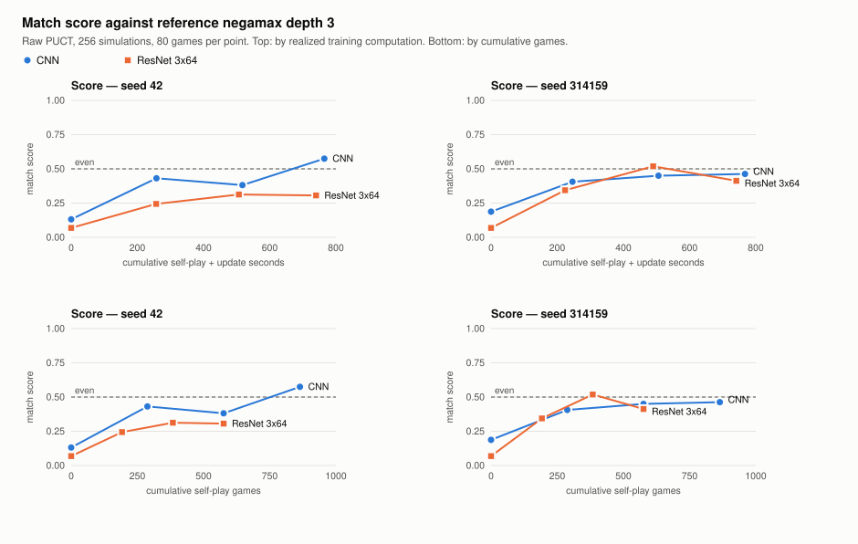
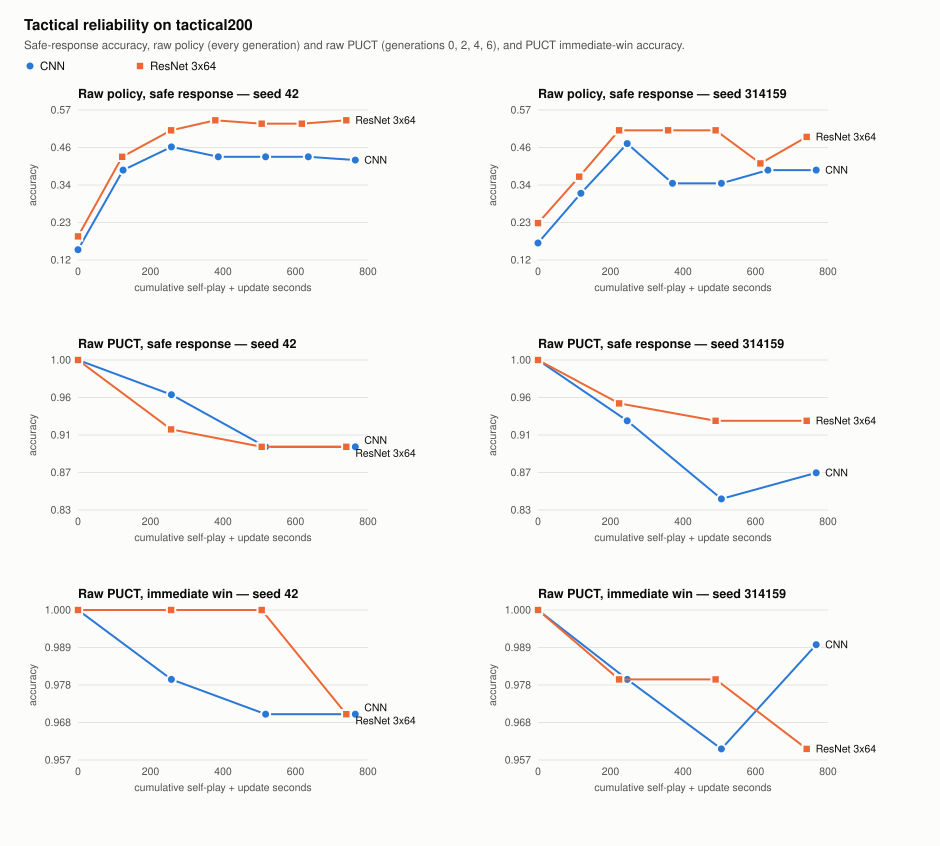
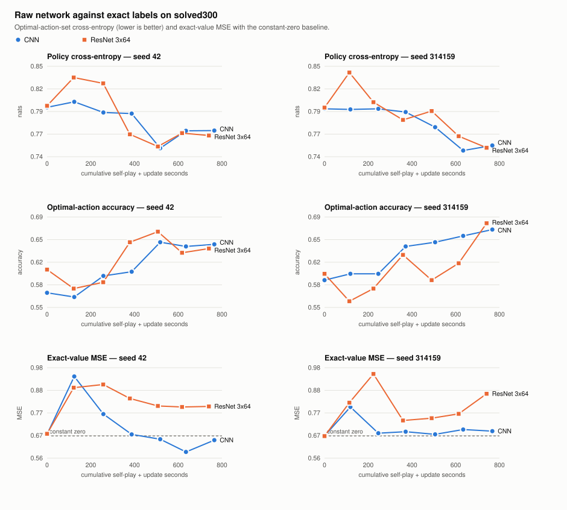
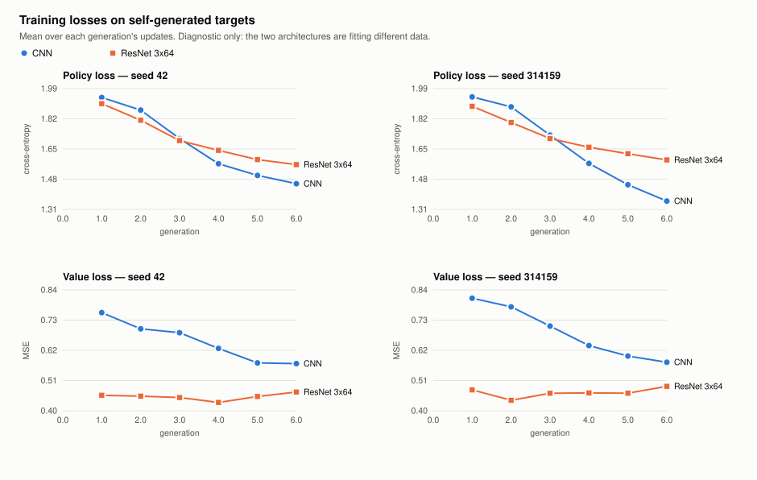

# Phase 4D.4H-C — controlled CNN vs ResNet 3x64 self-play experiment

## Summary

**ResNet 3x64 should not replace the CNN in the next AlphaZero campaign.** At
approximately equal training computation it showed no strength advantage, and
it costs about 1.5 times as much per position. Under the rule fixed before
training the strength comparison is a FAIL. The fair reading of that FAIL is
narrower than it sounds: the ResNet was clearly not better, and it was worse
in one training run of two.

| Conclusion | Result | Evidence at generation 6, ResNet minus CNN |
|---|---|---|
| Playing strength (primary) | **FAIL** | Match score -0.159, 95% interval [-0.263, -0.059]; seed 42 -0.269, seed 314159 -0.050 |
| Tactical reliability (gate) | PASS | Raw PUCT immediate win -0.015 [-0.044, +0.008]; safe response +0.030 [-0.032, +0.095] |
| Exact-value learning (supporting) | WORSE | Value MSE +0.165 [+0.049, +0.282] |
| Equal computation | Approximately equal | ResNet used 0.967 of the CNN's self-play plus update seconds |
| Declared recommendation rule | Keep the CNN | Strength FAIL |

How strong this is:

- **Supported: no strength advantage for the ResNet at this budget.** The
  pooled difference was at or below zero at all four evaluated checkpoints.
- **Not supported: "ResNet 3x64 is the weaker architecture".** The deficit is
  detectable on seed 42 only. On seed 314159 it is 4 points of 80 and within
  opening noise. The untrained networks already differ by -0.091 on this
  measure. One arm's score moves by up to 0.19 between adjacent checkpoints,
  as much as the difference between architectures, and at generation 4 the
  pooled difference was 0.000.
- **The ResNet ran under settings tuned for the CNN.** The shared gradient
  clip bound on about two thirds of its updates and on none of the CNN's.
- **This is a short pilot.** 576 and 864 games per arm say nothing about
  longer training.

What the ResNet did do better: its raw policy found the safe response more
often (+0.110 [+0.040, +0.180]). That did not carry into search or into match
results.

**Next investment: value learning.** After training, neither architecture's
value head beat a constant prediction of zero on exact labels, and the
ResNet's was more confident and further off. Search with an untrained
network solved every one-ply tactical position; search with the trained
networks did not. Details and the reasoning are under
[Recommendation](#recommendation).

The run completed all 60 tasks in 63.5 minutes with exact budgets, no retries
and every integrity check passing. An independent reviewer reproduced the
strength, tactical, value and computation results and every declared verdict,
and re-ran the final endpoints from the hashed checkpoints. It did not
recompute the training-dynamics measures. Nothing was merged, promoted or
deployed.

## Design and prospective freeze

Worktree `experiment-output/phase4d4h-c-worktree`, branch
`phase4d4h-c-resnet-selfplay`, from `6ef9148503a6e268cdcc2a51d9621c00e8e3a92e`.
The protocol is
[DESIGN.md](../research/alphazero_resnet_selfplay/DESIGN.md). It was committed
and pushed as **`18ba3b56f8fc517a96ae0d34247abb407c2922ce`** about 10
seconds before launch by local record, and the supervisor refused to launch
from anything else.

| | CNN | ResNet 3x64 |
|---|---|---|
| Parameters | 325,896 | 322,440 |
| Generations | 6 | 6 |
| Games and updates per generation | 144 | 96 |
| Total games and updates per arm | 864 | 576 |
| Seeds | 42, 314159 | 42, 314159 |

Both arms started from their fresh seed-determined initialization with an
empty replay and zero optimizer steps. Everything else was identical and
unchanged: original eight-ply schedule, 256 simulations, root noise 0.25 / 1,
pool-eight batched self-play, eight-generation replay, reflection 0.5, policy
cross-entropy plus value MSE, AdamW at 3e-4 with weight decay 1e-4, clip 5,
batch 128, the Phase 4D.4F deterministic runner on one thread.

The seed-42 CNN's initial weights are the same as the official campaign's
seed-42 generation 0, because both are the same seed's untrained
initialization. No trained weight was imported into any arm.

### Changes to the proposed design, made before the freeze

| Proposed | Frozen | Reason |
|---|---|---|
| 192 / 128 games and updates per generation | 144 / 96 | At the measured cost the proposed size needs about 75 minutes of training alone and does not fit the limit with evaluation and calibration |
| Evaluation budget not specified | 256 simulations | Time limit; equals the self-play budget |
| Sequential execution implied | Training sequential; evaluation in three parallel workers | Evaluation timing is not compared and its results do not depend on scheduling |

### What was frozen

| Item | Where |
|---|---|
| Model identities, hyperparameters, budgets, order | `results/design.json` |
| Evaluation positions, 40 opening families, opponent, seeds | `results/design.json`, `fixtures.json` (SHA-256 `80f68518…ca2c`, Phase 4D.4G's file) |
| Statistical methods and decision rules | `DESIGN.md`, `results/design.json`, `analyze.py` |
| Runtime and 48 execution-source hashes | `results/freeze.json` |
| Generation-zero boundary identities | `results/freeze.json` |

The package execution-source identity is unchanged from Phase 4D.4H-A
(`3523ee04…a934`): no file under `games/` was touched.

## Cost calibration

Done before the freeze with trained weights: Phase 4D.4H-B's saved
3,000-update CNN and ResNet states for both seeds, opened read-only and
hash-checked. Pool-eight, 256 simulations, ABBA half-generation blocks adding
up to one proposed generation per architecture. Evidence:
`results/calibration.json`.

| Measured | CNN | ResNet 3x64 | Ratio |
|---|---|---|---|
| Self-play, seconds per game | 0.942 | 1.434 | 1.52 |
| Self-play, ms per ply | 29.2 | 43.2 | 1.48 |
| Self-play, ms per neural position | 0.150 | 0.223 | 1.49 |
| Update, ms | 45.0 | 65.1 | 1.45 |
| Raw PUCT, seconds per fixture search | 0.041 | 0.074 | 1.79 |

These match Phase 4D.4H-B's untrained-network ratios (1.46 and 1.45), so the
proposed 3:2 ratio was kept. Processor time over wall time was 0.9996 or
higher, so the calibration was not disturbed.

**Opponent.** The rule was written into the calibration before the probe ran:
among reference-negamax depths 1 to 3, take the one whose mean score against
official CNN generation 2 to 4 checkpoints is closest to 0.50.

| Depth | Seed 42 g2, seed 42 g4, seed 314159 g3 (40 games each) | Mean |
|---|---|---|
| 1 | 0.738, 0.675, 0.613 | 0.675 |
| 2 | 0.313, 0.225, 0.375 | 0.304 |
| 3 | 0.525, 0.413, 0.475 | 0.471 |

Depth 3 was chosen. In the experiment the four final arms averaged 0.439
against it, so the endpoint was not saturated.

## Execution and integrity

| | |
|---|---|
| Started / training ended / finished | 13:56:09 / 14:48:59 / 14:59:42 local, 2026-10-12 |
| Final supervisor status | `COMPLETE_PENDING_ANALYSIS` |
| Tasks | 60 of 60 complete: 24 training, 16 match, 16 position, 4 dynamics |
| Failed, interrupted or retried | 0 |
| Work per arm | Exactly the frozen budgets: 864 / 864 (CNN), 576 / 576 (ResNet) |

Integrity checks at the end of the run, all strict:

| Check | Result |
|---|---|
| Frozen execution-source bytes, runtime and design | PASS |
| All 28 checkpoint hashes | PASS |
| 150 official campaign files | PASS, byte-identical |
| Protected experiment bytes: 4D.4G output (151 files) and results (132), 4D.4H-B output (78) and results (37), historical `games/` (77) | PASS, every launch-time file unchanged; none added |

External commits are recorded separately and are not an integrity criterion.
None occurred: the historical checkout (`1894bc4`), the 4D.4G worktree
(`01526b8`) and the 4D.4H-B worktree (`6ef9148`) had the same HEAD at launch
and at the end.

Pre-freeze validation (`results/validation.json`, 48 checks): both
architectures' adapters refuse each other's models and configurations, and
every generation produced by fresh interpreters is bit-identical to one
uninterrupted interpreter, including batch-norm buffers, optimizer state,
replay and every random stream.

### Checkpoint identities

Generation 0 and 6 shown; all 28 are in
[results/tables.md](../research/alphazero_resnet_selfplay/results/tables.md)
and `results/evidence-manifest.json`. Checkpoints stay local under
`experiment-output/phase4d4h-c/`.

| Arm | Generation | Boundary file SHA-256 |
|---|---|---|
| Seed 42 CNN | 0 | `5f9800bc86ff1efa21f4d2be5af04fa882c0a7015a454651c351479579e7ac21` |
| Seed 42 CNN | 6 | `ba2bde2ec71b3ac7486046d1cc26ab591bb59d6b764193ece08c6d6a6f24f58b` |
| Seed 42 ResNet | 0 | `a514f4df9c5b432f17f6ab06f177441272f4d2a0adb28b52f0294a71a145fc86` |
| Seed 42 ResNet | 6 | `429289d22e8b37354f9bd77dae97975081d3cdbae8c65357be4ad53b748d5503` |
| Seed 314159 CNN | 0 | `de89e765309e30376ac3e3e3f16861533751de2ab0264a79a8d6285525bdbe41` |
| Seed 314159 CNN | 6 | `2646d7cdee7d7b069412688bf95fd9794bea30402b4952120c904dbcb399401d` |
| Seed 314159 ResNet | 0 | `60c864e8a0303d80844b129cedd694a31cd3a0b34e063c2516fdf1958cd87c4f` |
| Seed 314159 ResNet | 6 | `b688095312730bc34886a9819864b772498544c83b6d0ae84ac3eb656879ec9d` |

## Realized computation

The compared quantity is self-play collection seconds plus optimizer-update
seconds.

| Arm | Games | Updates | Positions | Self-play s | Update s | Total s |
|---|---|---|---|---|---|---|
| Seed 42 CNN | 864 | 864 | 24,198 | 725.1 | 39.8 | 764.9 |
| Seed 42 ResNet | 576 | 576 | 15,539 | 701.9 | 38.2 | 740.1 |
| Seed 314159 CNN | 864 | 864 | 25,019 | 727.7 | 39.7 | 767.4 |
| Seed 314159 ResNet | 576 | 576 | 15,620 | 703.3 | 38.0 | 741.3 |

| ResNet / CNN | Seed 42 | Seed 314159 | Pooled | Expected |
|---|---|---|---|---|
| Total | 0.968 | 0.966 | **0.967** | 1.013 |
| Self-play | 0.968 | 0.966 | | |
| Updates | 0.961 | 0.957 | | |

The ratio is inside the declared 0.90 to 1.10 band on both seeds, so the
comparison is at approximately equal computation. The ResNet had 3.3% less,
not more. The cumulative ratio stayed between 0.91 and 1.00 at every
generation. Realized cost was below the calibration because games were
shorter (24 to 32 plies against 32 to 33).

Other measured rates, means over generations:

| | CNN | ResNet 3x64 |
|---|---|---|
| Games per second | 1.12 to 1.30 | 0.75 to 0.93 |
| Update, ms | 45.7 to 46.8 | 65.8 to 67.9 |
| Self-play, ms per ply | 28.0 to 32.1 | 43.6 to 48.1 |
| Neural positions per second in self-play | 6,677 to 6,823 | 4,347 to 4,563 |
| Mean inference batch (of 8) | 7.65 to 7.83 | 7.41 to 7.79 |
| Processor over wall time in collection | 0.992 to 1.000 | 0.995 to 1.000 |
| Task overhead beyond self-play and updates, mean seconds per generation | 6.0 to 6.1 | 4.0 to 4.1 |

Per-generation figures are in `results/tables.md`.

## Playing strength

Raw PUCT at 256 simulations against reference negamax depth 3, 40 opening
families times both colors, 80 games per arm and checkpoint.

| Generation | Seed 42 CNN | Seed 42 ResNet | Seed 314159 CNN | Seed 314159 ResNet |
|---|---|---|---|---|
| 0 | 0.131 | 0.069 | 0.188 | 0.069 |
| 2 | 0.431 | 0.244 | 0.406 | 0.344 |
| 4 | 0.381 | 0.313 | 0.450 | 0.519 |
| 6 | 0.575 | 0.306 | 0.463 | 0.413 |
| W/D/L at 6 | 44/4/32 | 22/5/53 | 35/4/41 | 32/2/46 |

ResNet minus CNN at the same generation (approximately equal computation):

| Generation | Seed 42 | Seed 314159 | Pooled | Supporting rule |
|---|---|---|---|---|
| 0 | -0.062 [-0.125, +0.000] | -0.119 [-0.212, -0.025] | -0.091 [-0.147, -0.034] | WORSE |
| 2 | -0.188 [-0.319, -0.050] | -0.062 [-0.188, +0.050] | -0.125 [-0.216, -0.034] | WORSE |
| 4 | -0.069 [-0.194, +0.056] | +0.069 [-0.062, +0.206] | +0.000 [-0.091, +0.094] | INCONCLUSIVE |
| **6 (decision)** | **-0.269 [-0.400, -0.138]** | **-0.050 [-0.206, +0.100]** | **-0.159 [-0.263, -0.059]** | **WORSE** |

**Declared rule: FAIL.** Both seeds are negative and the pooled interval
excludes zero. Conditional on these four networks, this opponent and these 40
openings the pooled deficit is robust: the reviewer's 200 bootstrap streams,
every leave-one-family-out, t intervals and an exact sign-flip test all agree
(p about 0.005).

As evidence about the architectures it is weak:

- **Seed 42 carries it.** Seed 42: 21 opening families behind, 5 ahead, exact
  p = 0.0005. Seed 314159: 15 behind, 14 ahead, p = 0.58. Seed 42 supplies 84%
  of the pooled difference, and the two seeds differ from each other by more
  than opening noise explains.
- **The untrained networks already meet the FAIL conditions.** At generation
  0 the difference was -0.091 [-0.147, -0.034] before any learning. So an
  interval that excludes zero on this measure does not by itself show a
  learned difference. Measured as gain from generation 0, the seeds disagree:
  -0.206 on seed 42 and +0.069 on seed 314159.
- **Generation 6 is one checkpoint of a noisy trajectory.** The seed 42 CNN
  went 0.431, 0.381, 0.575; the seed 314159 ResNet went 0.344, 0.519, 0.413.
  Generation 6 was fixed in advance, so the verdict stands, but it depends on
  whether the seed-42 CNN's last jump of +0.194 is durable learning or
  checkpoint noise, and the data cannot tell.
- **By color at generation 6**, the deficit is concentrated as O: -0.244
  [-0.369, -0.119] as O against -0.075 [-0.219, +0.069] as X. Scores as X and
  as O were 0.363 / 0.250 and 0.525 / 0.300 for the ResNet, 0.563 / 0.588 and
  0.475 / 0.450 for the CNN.

Differences by opening family and seed are in `results/tables.md`.

**Equal cumulative games (descriptive).** CNN generation 4 against ResNet
generation 6, 576 games and updates each: -0.056 [-0.150, +0.041], seed 42
-0.075, seed 314159 -0.037. Inconclusive. It shows no per-game advantage for
the ResNet, which needed about 1.45 times the time to play those games. It
does not show that the ResNet learns as well, or worse, per game: the pairing
is confounded by generation count and happens to meet the seed-42 CNN at its
lowest trained checkpoint.

## Tactical reliability

tactical200: 100 immediate-win and 100 safe-response positions.

| Generation 6 | Seed 42 CNN | Seed 42 ResNet | Seed 314159 CNN | Seed 314159 ResNet |
|---|---|---|---|---|
| Raw policy, immediate win | 0.30 | 0.30 | 0.32 | 0.40 |
| Raw policy, safe response | 0.42 | 0.54 | 0.39 | 0.49 |
| Raw PUCT, immediate win | 0.97 | 0.97 | 0.99 | 0.96 |
| Raw PUCT, safe response | 0.90 | 0.90 | 0.87 | 0.93 |
| Raw PUCT, deeper mistakes on solved300 | 0.237 | 0.240 | 0.223 | 0.233 |
| Raw PUCT, deeper mistakes on deep128 | 0.234 | 0.320 | 0.250 | 0.328 |

| Contrast at generation 6 | Pooled | Rule |
|---|---|---|
| Raw PUCT immediate win | -0.015 [-0.044, +0.008] | |
| Raw PUCT safe response | +0.030 [-0.032, +0.095] | |
| **Gate (raw PUCT)** | | **PASS** |
| Raw policy immediate win | +0.040 [-0.037, +0.123] | INCONCLUSIVE |
| Raw policy safe response | +0.110 [+0.040, +0.180] | BETTER |
| Raw policy gate (not binding) | | PASS |
| Raw PUCT avoidable one-ply errors | -0.015 [-0.049, +0.016] | INCONCLUSIVE |
| Raw PUCT deeper mistakes, deep128 | +0.082 [-0.004, +0.176] | INCONCLUSIVE |

The ResNet is not shown less reliable than the CNN under search, within the
declared margin. That is a weak statement: the margin is wide against error
rates of 1% to 13%, and both architectures are below an uninformed search
(next paragraph). Its raw policy is better at safe responses at generations 3,
4 and 6 (+0.135, +0.130, +0.110) and at equal games (+0.125 [+0.062, +0.189]).
Its deeper-mistake rate on deep128 leans worse (WORSE at generation 4,
inconclusive at 6).

**Search with an untrained network solved all 200 positions; search with
trained networks did not.** At generation 0 every arm scored 1.00 on both
categories with raw PUCT. At generations 2 to 6, safe-response accuracy was
0.84 to 0.96 and immediate-win accuracy 0.96 to 1.00, for both architectures.
With near-uniform priors and near-zero values, 256 simulations find every
one-ply tactic through terminal nodes. Learned priors and values then steer
visits away from some of them. This is the one-ply weakness earlier phases
reported, seen here appearing during training.

## Policy and value quality

Raw network against exact labels on solved300.

| Generation 6 | Seed 42 CNN | Seed 42 ResNet | Seed 314159 CNN | Seed 314159 ResNet |
|---|---|---|---|---|
| Optimal-action-set cross-entropy | 0.769 | 0.763 | 0.751 | 0.748 |
| Optimal-action accuracy | 0.647 | 0.640 | 0.670 | 0.680 |
| Probability on optimal actions | 0.606 | 0.602 | 0.608 | 0.610 |
| Exact-value MSE | 0.647 | 0.803 | 0.689 | 0.862 |
| Constant-zero MSE | 0.667 | 0.667 | 0.667 | 0.667 |
| Value calibration error, ten bins | 0.226 | 0.376 | 0.289 | 0.436 |
| Share of values beyond 0.95 in magnitude | 1.7% | 4.3% | 1.0% | 8.3% |

| Contrast at generation 6 | Pooled | Rule |
|---|---|---|
| Policy cross-entropy | -0.004 [-0.055, +0.040] | INCONCLUSIVE |
| Optimal-action accuracy | +0.002 [-0.040, +0.047] | INCONCLUSIVE |
| **Exact-value MSE** | **+0.165 [+0.049, +0.282]** | **WORSE** |
| Exact-value MSE, deep128 | -0.104 [-0.285, +0.059] | INCONCLUSIVE |

**Policy: no difference.** Both improved modestly from the untrained 0.80
nats and 0.57 to 0.61 accuracy.

**Value: neither head beats a constant, and the ResNet's is more confident
and further off.** The CNN ends at 0.97 and 1.03 times the constant-zero error
(slightly better on seed 42, slightly worse on seed 314159). The ResNet is at
1.20 and 1.29 times, above the constant at every generation from 1 to 6 on
both seeds, and above the CNN by the supporting rule at generations 2, 4, 5
and 6.

The reviewer found why the verdict depends on the suite. The ResNet's value is
biased toward the side to move: its mean value on the balanced solved300 is
+0.18 and +0.33, against -0.08 and +0.02 for the CNN. Its error is 1.30 and
1.71 on lost positions and 0.69 and 0.50 on won ones. On deep128, which has no
lost positions, the sign of the contrast reverses and is inconclusive. So this
is not evidence that the CNN learned the better value function. It has the
less biased of two uninformative ones.

### Training against held-out value error

Held-out here is prequential: the network of generation g scored on the games
of generation g+1, which it generated and was not trained on.

| | Seed 42 CNN | Seed 42 ResNet | Seed 314159 CNN | Seed 314159 ResNet |
|---|---|---|---|---|
| Training-replay value MSE, generations 1 to 5 | 0.57 to 0.68 | 0.28 to 0.47 | 0.57 to 0.75 | 0.32 to 0.42 |
| Held-out value MSE, generations 1 to 5 | 0.66 to 0.87 | 0.84 to 1.03 | 0.67 to 0.94 | 0.95 to 1.05 |
| Constant-zero MSE on the same games | 0.71 to 0.83 | 0.79 to 0.92 | 0.67 to 0.87 | 0.82 to 0.90 |
| Generations where held-out beats the constant | 3, 4, 5 | none | 2, 3, 4 | none |
| Held-out minus training, generations 1 to 5 | +0.01 to +0.21 | +0.46 to +0.69 | -0.00 to +0.20 | +0.53 to +0.69 |

The ResNet fits the outcomes of the games in its replay far more tightly and
predicts the outcomes of its own next games worse than a constant. The CNN
fits less and generalizes somewhat. This agrees with Phase 4D.4H-B, where the
ResNets' values saturated earlier on fixed data.

## Training dynamics

| Generation 6 unless stated | Seed 42 CNN | Seed 42 ResNet | Seed 314159 CNN | Seed 314159 ResNet |
|---|---|---|---|---|
| Mean policy loss, generation 1 to 6 | 1.94 to 1.45 | 1.90 to 1.56 | 1.94 to 1.35 | 1.89 to 1.59 |
| Mean value loss, generation 1 to 6 | 0.76 to 0.57 | 0.45 to 0.47 | 0.81 to 0.58 | 0.47 to 0.49 |
| Mean gradient norm | 1.71 | 5.41 | 1.64 | 5.89 |
| Updates clipped at 5 | 0% | 76% | 0% | 97% |
| Self-play duplicate positions after ply 8 | 22.1% | 7.1% | 36.1% | 4.0% |
| Distinct games of those played | 132 / 144 | 93 / 96 | 123 / 144 | 95 / 96 |
| Mean visit-target entropy, nats | 0.90 | 1.05 | 0.75 | 1.02 |
| Replay positions | 24,198 | 15,539 | 25,019 | 15,620 |
| Replay mirror-duplicate share | 26.2% | 23.9% | 35.5% | 21.5% |
| Avoidable one-ply errors per self-play position | 0.75% | 1.20% | 0.27% | 0.84% |

Three things stand out. They were observed after the run and are not part of
the declared analysis.

- **The shared gradient clip binds for the ResNet and never for the CNN.**
  From generation 2 on, 43% to 97% of ResNet updates were clipped; no CNN
  update was. The clip, like the learning rate, was chosen for the CNN. The
  design held hyperparameters identical on purpose, but identical is not
  equally tuned, and this is a concrete reason the ResNet may have been
  handicapped.
- **The CNN's self-play is collapsing onto repeated lines; the ResNet's is
  not.** CNN post-ply-8 duplicates rose from 0% to 22% and 36% over six
  generations while the ResNet's stayed under 8%. The CNN's lower policy
  loss partly reflects this easier, more repetitive target.
- **Training losses are not comparable between arms.** Each fits its own
  data. The ResNet's lower value loss is the overfitting described above.

No update produced a nonfinite value. All replay stayed inside the
eight-generation window, so nothing was evicted.

### Batch normalization

| | Generation 0 | Generation 1 | Generations 2 to 6 |
|---|---|---|---|
| Eval-mode minus train-mode policy cross-entropy | -0.055, -0.074 | +0.004 | 0.000 to +0.005 |
| Choices that differ between modes | 69%, 76% | 13%, 17% | 7% to 12% |
| Mean absolute value difference between modes | 0.09, 0.07 | 0.03, 0.07 | 0.04 to 0.10; 0.22 once |
| Worst standardized running-mean shift | 0.60, 0.59 | 0.05 | 0.04 to 0.05 |
| Smallest running variance | 1.000 | 0.025, 0.033 | 0.027 to 0.039 |

Running statistics track the data from generation 1. Every update counter
equals the trainer's step count. No variance collapsed. Generation 1 self-play
necessarily used the untrained statistics, as expected. The value output stays
more mode-sensitive than the policy; the one large value (0.22, seed 314159
generation 6) coincides with that arm's worst exact-value error.

## The scientific questions

| Question | Answer |
|---|---|
| 1. Does the ResNet learn useful tactics sooner? | Partly, in the raw policy only. Its safe-response accuracy led at generations 3, 4 and 6 and at equal games. Immediate-win accuracy and all raw-PUCT tactics were not different. |
| 2. Does the CNN catch up when given more updates? | On pooled strength it was ahead or level at every checkpoint at equal computation, so there was nothing to catch up; on seed 314159 the ResNet was ahead once, at generation 4. On raw safe-response accuracy the CNN did not catch up within six generations. |
| 3. Does either develop a more reliable value network? | No. Neither beats a constant on exact labels. The ResNet's is more confident, biased toward the side to move, and overfits its replay. |
| 4. Do better raw predictions translate into stronger PUCT? | No. The ResNet's raw safe-response lead produced no PUCT tactical lead and a lower match score. Raw policy quality on exact labels was equal while strength differed. |
| 5. Does the ResNet improve strength at equal computation? | No. FAIL under the declared rule; the supported statement is that it showed no advantage and was worse in one run of two. |
| 6. Is any advantage consistent across both seeds? | The raw-policy safe-response lead is (+0.12 and +0.10). The strength deficit has the same sign on both seeds at generations 0, 2 and 6 but not at 4, and is detectable on only one. |

## Independent results review

A separate reviewer with no part in the design, run or analysis recomputed
the results from the raw evidence with its own code, which shares nothing with
this phase's analysis:
[independent-results-review.md](../research/alphazero_resnet_selfplay/independent-results-review.md),
`independent_review.py`, `results/independent-recomputed.json`. It is a review
on the same host, not an external replication.

What it confirmed:

- All 1,280 match games replay legally to the recorded results, on the 40
  declared opening families with both colors.
- 1,229 point estimates match the frozen analysis exactly. Interval ends from
  a different random stream differ by at most 0.009. All six declared verdicts
  agree, and no supporting verdict changes.
- The strength FAIL holds on 200 of 200 further bootstrap streams, on every
  leave-one-opening-family-out, with t intervals and with an exact sign-flip
  test (p about 0.005).
- Re-running the generation-6 endpoints from the hashed checkpoints reproduces
  the stored raw outputs, tactical searches and all 320 match games exactly.
- Tactical labels, re-derived independently for all 200 positions, and every
  stored correctness flag agree.
- Budgets, the model chain, all 28 checkpoint hashes, the 48 frozen source
  hashes, the ABBA order and strictly sequential training are as declared.
  No task failed or was retried.

What it found. There is no critical finding and nothing changes a number or a
declared verdict; the findings are about what the verdicts can carry.

| Finding | Severity | Response in this report |
|---|---|---|
| The strength FAIL rests on one seed. Seed 42: exact p = 0.0005. Seed 314159: p = 0.58, and removing two of 40 opening families makes its difference non-negative | Moderate | Summary and strength section say the deficit is detectable on seed 42 only |
| The untrained networks already meet the FAIL conditions (-0.091 [-0.150, -0.034]). Measured as gain from generation 0 the seeds disagree: -0.206 and +0.069 | Moderate | Stated in the strength section with its consequence: an interval excluding zero here does not by itself show a learned difference |
| One arm's score moves between adjacent checkpoints by up to 0.194, as much as the architecture difference. The FAIL depends on whether the seed-42 CNN's last jump is learning or noise | Moderate | Stated in the summary and strength section |
| The two seeds do not estimate the same difference (z = -2.09). With seeds as the unit of replication the interval is [-1.55, +1.23] | Moderate | Stated under limitations; the summary no longer describes the ResNet as shown weaker |
| The value WORSE verdict compares two heads that are both no better than a constant. The ResNet's is biased toward the side to move (mean value +0.18 and +0.33 on a balanced suite), and the sign reverses on deep128, which has no lost positions | Moderate | Value section reworded; the report does not say the CNN learned a better value function |
| The tactical gate is weakly informative: untrained search scores 1.00, and the margin is wide against these error rates | Minor | Tactical section says "not shown less reliable within the declared margin" |
| 36 of 162 supporting contrasts are flagged, and as many fire between untrained networks as between trained ones | Minor | Only the two repeated patterns are relied on: raw-policy safe response and solved300 value |
| The deficit is concentrated as O, and "moving first / second" was inexact | Minor | Reworded to "as X / as O"; figures added |
| The equal-games pairing supports nothing beyond the absence of a per-game advantage | Minor | Kept descriptive |
| Three sentences in the draft were too strong | Minor | Corrected |
| Shared optimizer settings were not neutral: 62% and 65% of ResNet updates clipped, none of the CNN's | Note | Already reported; restated in the summary |
| The freeze-before-training order rests on local clocks: commit and push about 10 s before launch | Note | Stated as such |

Not covered by the review: training was not re-run; stored outputs at
generations 0 to 5 were checked for consistency, not re-executed; the dynamics
measures (replay, diversity, held-out losses, batch norm) were not recomputed;
about half of the exact solved labels were not re-solved; and the preservation
inventories of other phases were quoted, not re-hashed.

## Limitations

- **Two seeds, one initialization each.** The intervals describe these four
  networks on these fixtures. They do not include run-to-run training
  variation, and it is not small: the two seeds' differences disagree by 0.219
  (z = -2.09 under opening sampling alone). With the seed as the unit of
  replication the interval is [-1.55, +1.23], which says nothing.
- **Evaluation is deterministic.** The 80 games per arm are fully determined
  by the weights. The bootstrap treats the 40 opening families as the sample.
- **The measure is sensitive to things that are not learned strength.** The
  untrained networks differ on it by -0.091.
- **The rule was asymmetric.** PASS needed a 0.05 margin and a non-negative
  generation-4 difference; FAIL needed two negative signs and an interval
  below zero. A symmetric FAIL would still have been met.
- **A single decision checkpoint.** Fixed in advance, but one draw from a
  noisy trajectory.
- **A short pilot.** 576 and 864 games. Official training ran 5,120.
- **Identical hyperparameters are not equally tuned.** The clip threshold
  binds for the ResNet only.
- **Equal simulations, not equal time, in evaluation.** A ResNet simulation
  costs about 1.5 to 1.8 times a CNN one, so at equal thinking time the ResNet
  would have searched less. This favors the ResNet and does not change the
  conclusion.
- **One weak opponent, chosen with CNN checkpoints**, and one search budget
  (256, not the deployed 512). There is no second opponent and no direct match
  between the arms.
- **No multiplicity correction.** One primary endpoint; the supporting
  contrasts are many and isolated verdicts among them deserve little weight.
- **Mechanisms are observations, not tests.** The clipping, overfitting and
  diversity findings were seen after the run.

## Resource accounting

| Item | Seconds |
|---|---|
| Cost calibration | 549.7 |
| Pipeline smoke test | 51.9 |
| Pre-freeze validation | 8.8 |
| Training phase (24 generations, sequential) | 3,170.3 |
| Evaluation phase (36 tasks, three workers) | 642.3 |
| **Measured run** | **3,812.5 (63.5 min)** |
| **Run plus calibration, smoke and validation** | **4,422.9 (73.7 min)** |
| Projected for the run before launch | 4,627 |
| Run ceiling / hard maximum | 6,590 / 7,200 |

| Task kind | Tasks | Processor seconds |
|---|---|---|
| Training | 24 | 3,127 |
| Matches | 16 | 949 |
| Positions | 16 | 683 |
| Dynamics | 4 | 198 |

Child-process processor time for the run was 5,027 s and the largest peak
resident memory of any task was 399 MiB. The run made 2,880 self-play games,
80,376 positions, 2,880 optimizer updates and 1,280 match games. Not counted:
the frozen analysis (a few seconds), the independent review and the
regression sweep.

## Preservation

- All 150 official campaign files are byte-identical; the declaration hash is
  still `c8ab2227…b716`.
- The historical checkout is at `1894bc4` and clean; its `games/` tree is
  unchanged by hash.
- Phase 4D.4G and Phase 4D.4H-B outputs and results are unchanged by hash,
  before calibration, at launch and at the end.
- This branch adds only `docs/phase4d4h-c-resnet-selfplay.md`,
  `research/alphazero_resnet_selfplay/` and
  `tests/test_alphazero_resnet_selfplay.py`. No file under `games/`, the
  canonical benchmark, the API, the UI or any deployed agent changed.
- The full AlphaZero regression sweep passes: 627 passed, 2 skipped
  (`results/regression-tests.txt`). The two skips are the existing optional
  retained-v1-checkpoint checks.

## Recommendation

**Keep the CNN for the next substantial campaign. Do not adopt ResNet 3x64
now.**

The declared rule gives "keep the CNN" because strength is a FAIL. The more
cautious reading, which the independent review supports, reaches the same
decision on cost alone: the ResNet costs about 1.5 times as much per position
and nothing here shows it buying strength with that cost.

This result is not a reason to launch a longer ResNet campaign, and it is not
evidence that one would fail: the pilot is silent on longer training. The
ResNet is not shown to be incapable. If it is revisited, the clip threshold is
the first thing to fix, together with a value target that it cannot memorize.

**Next investment: value learning.** This is a judgment informed by the
indicators declared before the run, not an automatic selection.

| Declared indicator | Fired? | Evidence |
|---|---|---|
| Value learning: exact-value MSE at or above 0.9 times the constant-zero MSE in both architectures, or held-out value MSE above the constant | Yes | 0.647 and 0.689 (CNN), 0.803 and 0.862 (ResNet) against a 0.600 threshold; ResNet held-out worse than the constant at every generation |
| Tactical search: raw-PUCT immediate-win or safe-response accuracy below 0.95 in the better arm | Yes | CNN safe response 0.90 and 0.87 |
| Replay optimization: replay mirror duplicates above 0.40, or post-ply-8 self-play duplicates above 0.30, in the better arm | On one seed | CNN post-ply-8 duplicates 36.1% (seed 314159) and 22.1% (seed 42); replay mirror duplicates 35.5% and 26.2% |

Why value learning first:

- It is the common failure. Both architectures, both seeds, and Phase 4D.4H-B
  on fixed data all show a value head that does not generalize. Phase 4D.4G
  measured the official generation-20 CNN at 0.59 to 0.61 on the same
  positions, against the constant's 0.667, after 5,120 games.
- It plausibly drives the other two. Search guided by an unreliable value is
  what turns a 1.00 one-ply record into 0.84 to 0.96, and a value trained on
  single game outcomes from repeated lines is what a collapsing replay feeds.
- It is where the architectures differed most. The ResNet fits game outcomes
  in its replay tightly (0.28 to 0.47 against the CNN's 0.57 to 0.75) and
  predicts its next games worse than a constant, so more capacity made the
  value target's weakness worse, not better.

Tactical search is the cheaper, narrower fix and a reasonable second: the
untrained-network result shows that 256 simulations can already solve these
positions, so the loss is in how learned priors and values direct search.
Replay optimization comes third: the CNN's rising repetition is real but is a
trend on one seed at this length.

Not recommended from this evidence: a longer ResNet run, ResNet 5x64, or any
promotion.

## Requirement status

| Requirement | Status | Evidence |
|---|---|---|
| Dedicated branch and worktree from `6ef9148` | PASS | Worktree list; branch pushed |
| CNN and ResNet 3x64 only, seeds 42 and 314159, from scratch | PASS | `results/freeze.json` initial boundaries |
| Empty replay and zero optimizer steps; no historical weights | PASS | Generation-zero checks in `prepare.py`; `results/validation.json` |
| Original schedule, 256 simulations, pool eight, unchanged replay, losses and AdamW | PASS | `results/design.json` configurations |
| Bounded calibration with trained weights, read-only | PASS | `results/calibration.json`; protected trees intact |
| Budgets adjusted only before the freeze; expected time and ratio recorded | PASS | `results/design.json` budget |
| Realized computation reported separately | PASS | Realized computation section |
| Model-factory and boundary compatibility; fresh-process resume for both | PASS | `results/validation.json`, 48 checks |
| Models, budgets, evaluation, seeds, statistics, rules, runtime and sources frozen | PASS | `results/freeze.json`, `DESIGN.md` |
| Prospective design committed and pushed before training | PASS | `18ba3b5`; enforced at launch |
| Frozen sources unchanged during training | PASS | Enforced in every worker and at the end |
| Evaluation at generation 0, intermediate and final checkpoints | PASS | Generations 0, 2, 4, 6; raw network at all seven |
| Policy, value, tactical, strength and dynamics measures | PASS | Sections above; `results/tables.md` |
| Same fixed opponent and configuration for every model | PASS | Reference negamax depth 3, 256 simulations |
| Paired differences by opening family and seed | PASS | `results/tables.md` |
| PASS, FAIL and INCONCLUSIVE rules fixed in advance | PASS | `DESIGN.md` |
| Detached managed process, hard deadline, cancellation, no retries | PASS | `manage.py`; supervisor log |
| 60 to 90 minute target, 120 minute maximum | PASS | 63.5 minutes; 73.7 with calibration |
| Strict integrity checks; HEAD not used as proof | PASS | Execution and integrity section |
| Independent critical review | PASS, no critical finding; five moderate findings on interpretation, all reflected here | `independent-results-review.md` |
| Final results committed and pushed | PASS | This commit |
| No merge, deployment, promotion or longer campaign | PASS | — |
